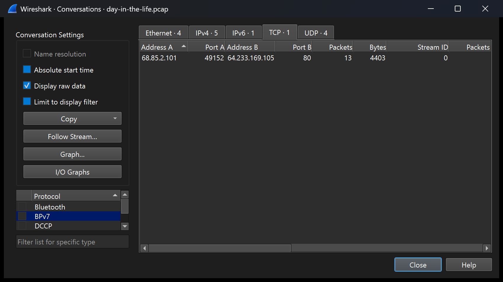
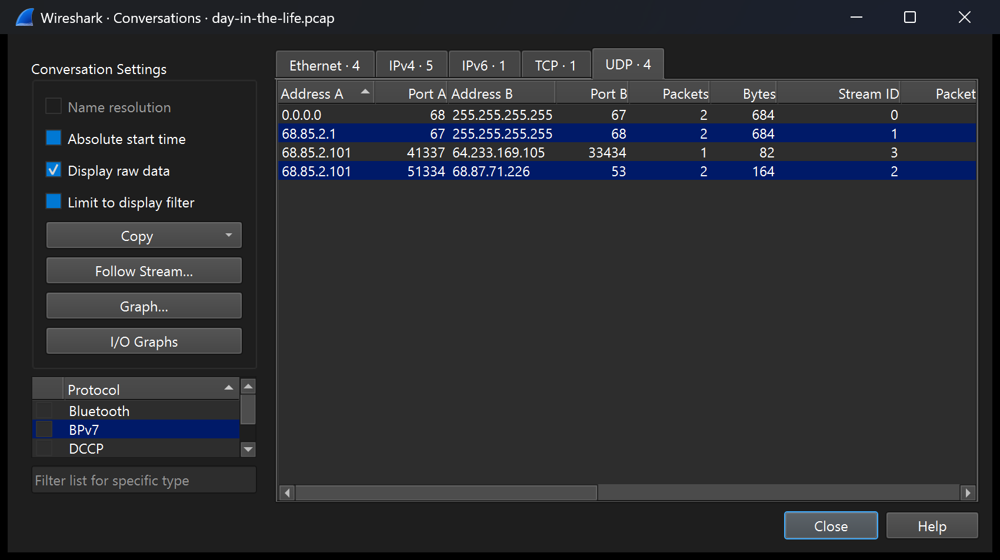
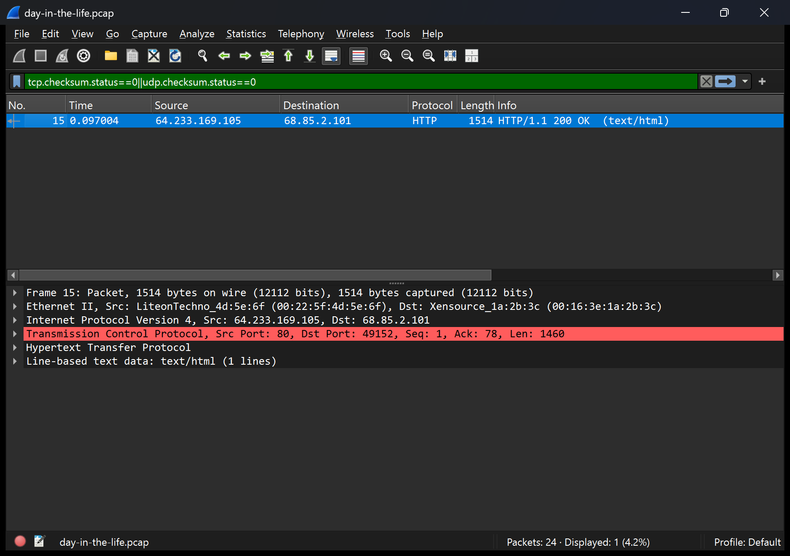
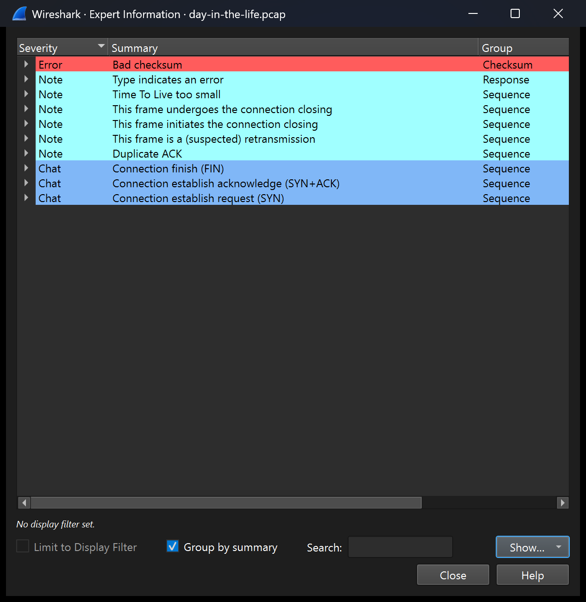
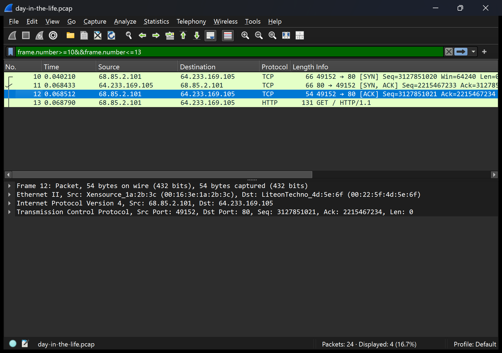
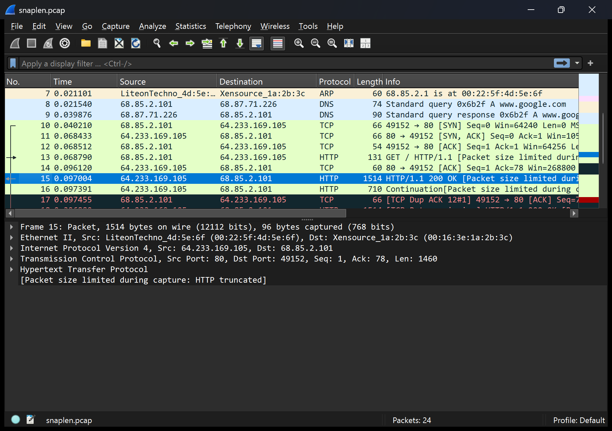

# Submission Report

- Submission generated at 11/22/2026 at 19:49:54

- Machine info: Linux runnervm0hi8g 7.0.0-1020-azure #21-Ubuntu SMP PREEMPT Tue Oct 27 22:34:38 UTC 2026 x86_64 GNU/Linux

## Note to Students

Please read this report carefully before submission.
Ensure that all sections are complete and accurate.
Look for any errors in the build or test outputs.
If you find any issues, correct them before submitting.
Post any questions on the class discussion board for help.


---

## README

# Project 4 - Packet Capture and Analysis

- Name: Randy Bauer
- Email: randybauer@u.boisestate.edu
- Class: CS425-001

A pcap decoder in C. For every frame in a capture, it walks down the stack (Ethernet, then ARP or
IPv4, then TCP or UDP) and prints one line. Then it prints a summary of every TCP and UDP flow.
The main capture is the textbook's "day in the life of a web page request" (Kurose 9th edition,
section 6.7).

## Building and running

```bash
make all && make check
./build/release/myapp day-in-the-life.pcap
./build/release/myapp -s day-in-the-life.pcap        # flow summary only
./build/release/myapp malformed.pcap | diff - malformed.txt
```

The five captures and `malformed.txt` from `p4-captures.zip` are in the repository root.

| Exit code | Meaning |
| --- | --- |
| 0 | The whole capture was read, or there were no arguments at all (prints usage). A broken frame is reported on its line and is not an error |
| 1 | Bad command line: an unknown option, no capture, or more than one |
| 2 | The file cannot be read, or is not a well formed pcap file |

On exit 2, the program prints every frame before the problem. Then it writes a message on stderr
that names the problem and the frame, for example
`myapp: truncated.pcap: frame 13: record data runs past the end of the file`, and it skips the
summary. A pcapng file gets a message that says it is pcapng.

## Design

The program has three layers. Each one is a section of `src/lab.h` and has its own source file.

| Layer | File | Job | Functions |
| --- | --- | --- | --- |
| 1. The pcap reader | `src/pcap.c` | Opens a capture that is already in memory, checks the file header, and hands out one record at a time | `pcap_open`, `pcap_next`, `pcap_strerror` |
| 2. The header parsers | `src/headers.c` | Turns bytes into structs, verifies checksums, formats addresses and flags. No I/O and no allocation | `eth_parse`, `arp_parse`, `ipv4_parse`, `tcp_parse`, `udp_parse`, `inet_checksum`, `pseudo_header_sum`, `format_mac`, `format_ipv4`, `format_tcp_flags` |
| 3. Decoding and reporting | `src/decode.c` | Walks one frame down the stack, keeps the flow table, and runs a whole capture into a `FILE *` | `decode_frame`, `flow_table_create`, `flow_table_destroy`, `flow_table_add`, `flow_table_count`, `flow_table_get`, `format_flow`, `format_elapsed`, `report_capture` |
| The program | `src/main.c` | Reads the file into memory, parses the command line with `getopt`, and calls `report_capture` | none public |

Layers 1 and 2 don't use each other. Layer 3 uses both. Nothing below `main.c` opens a file.
`report_capture` writes to the `FILE *` pointers it is given, so a test can point it at
`tmpfile()` and read back what it wrote.

### Never read a byte you have not checked

Every function that reads bytes takes a pointer and a length. A parser checks the length before it
reads each field. When the header doesn't fit it returns `PARSE_SHORT`, and when the header fits
but breaks a rule it returns `PARSE_ILLEGAL`. On any failure it leaves its output struct
untouched. The pcap reader compares a record's captured length with the bytes left in the file
instead of adding it to the current position. That way a hostile length like `0xffffffff` can't
wrap the arithmetic around.

### Byte order

The pcap headers are in the byte order of the machine that wrote the file. `pcap_open` reads the
magic number both ways, and whichever way gives `0xa1b2c3d4` sets the order for every pcap header
after it. The frames themselves are always big endian. Every multi-byte value is built a byte at a
time with shifts, and each byte is widened to an unsigned type first. A `uint8_t` promotes to
`int`, and `0xd4 << 24` overflows an `int`. That overflow is undefined behavior, and the compiler
gives no warning for it.

### Four lengths

| Length | Comes from | Used for |
| --- | --- | --- |
| Captured length | The pcap record header | How many bytes may be read. `cksum=partial` when the segment isn't all there |
| Original length | The pcap record header | The flow summary's `bytes=`, and telling whether the snaplen cut the frame short |
| IPv4 total length | The IPv4 header | Where the datagram ends. Anything after it is Ethernet padding |
| UDP length | The UDP header | UDP `len=`, and how much the UDP checksum covers |

TCP `len` is the total length minus IHL × 4 minus the data offset × 4. UDP `len` is the UDP length
minus 8. Neither comes from the frame length. Frames 14 and 21 are padded to 60 bytes, so a
length taken from the frame would say 6 where the right answer is 0. The checksum covers the
segment as the headers define it, so the padding is never summed.

### Checking in order

`decode_frame` follows the handout's eight steps and stops at the first problem: Ethernet, ARP,
IPv4, the IPv4 header checksum, fragments, the protocol, then TCP or UDP. The IPv4 total length
may run past the captured bytes only when the frame's original length is longer than its captured
length, which means the snaplen cut it. The TCP and UDP checks measure against the IPv4 payload:
the smaller of the total length and the captured bytes, minus the header. The header is IHL × 4
bytes, so options are skipped, and padding can't make a short TCP header look complete.

### Checksums

`inet_checksum` adds the bytes as 16-bit big endian words in a 64-bit sum, padding an odd last
byte with a zero. It folds the carries back in until there are none left, because a single fold
can carry again (`0x1ffff` becomes `0x10000`). Then it returns the complement. To verify a
segment, it sums the segment, checksum field included, starting from `pseudo_header_sum` (the
addresses, the protocol and the length). A correct segment gives 0. A UDP checksum field of 0
means the sender didn't compute one, and prints `none`.

### The flow table

A flow is a protocol and two endpoints, in either direction. `flow_table_add` looks for the key
both ways round. A new flow keeps the orientation of its first packet, so side A is the source of
the first packet seen. The flows are kept in an array, in the order they were first seen. The
array starts at 8 and doubles, with `realloc` into a temporary pointer so a failure leaves the
table as it was. Each lookup is a linear search, which is plenty for captures this size.

### Time

`format_elapsed` works in whole microseconds in an `int64_t`. A timestamp's seconds field is
32 bits, and 2^32 seconds times a million still fits. There is no floating point, so there is no
rounding.

## Testing

`tests/lab-test.c` has 98 Unity tests and covers every function declared in `src/lab.h`.
`make report` gives 100% line coverage of `pcap.c`, `headers.c` and `decode.c` (391 of 391
lines). The only exclusions are the branches for `malloc` and `realloc` returning NULL.

- **Byte arrays:** real frames copied out of `day-in-the-life.pcap`, plus synthetic frames built in
  the test and broken one field at a time. They cover every malformed case in the handout's list,
  an IPv4 header with options, a padded frame, frames cut short by the snaplen, odd-length
  segments, a checksum that carries twice, and the RFC 1071 example.
- **pcap files** in both byte orders, cut off inside the file header (after 7 bytes), inside a
  record header and inside a record's data. A record whose captured length is larger than its
  original length, and one whose length is `0xffffffff`.
- **The flow table:** a flow seen in both directions, the same endpoints over TCP and UDP, and
  growth to 100 flows.
- **`report_capture`** writes into `tmpfile()`, and the test reads the text back.
- **The real captures:** the last four tests run the captures from the repository root.
  `malformed.pcap` must match `malformed.txt`, and the big endian file must print exactly what the
  little endian one does. `truncated.pcap` must print 12 frames and exit 2, and `snaplen.pcap`
  must show `partial`.

Checks outside the unit tests (not submitted):

- The output on each capture was compared, field by field, with `tshark` (Wireshark's command-line
  version, 4.2.2 in WSL and 4.6.10 on Windows). It is identical on `day-in-the-life.pcap` and
  `snaplen.pcap`.
- The program was built with `-fsanitize=address,undefined` and run on 3000 randomly mutated
  captures (flipped bytes, cut files, extreme length fields). There were no sanitizer reports, and
  every run exited 0 or 2.
- The command line was checked separately: no arguments, a bad option, `-s` alone, two files, a
  missing file, a directory, an empty file, a text file, a pcapng file, and a capture read from a
  pipe.

## Wireshark

Checked in Wireshark 4.6.10 on Windows, with `day-in-the-life.pcap`. Wireshark sorts the
conversations by Address A, and my summary lists them in the order they were first seen, so the
rows below follow my order.

### Statistics → Conversations

| Flow | My packets | My bytes | Wireshark packets | Wireshark bytes |
| --- | --- | --- | --- | --- |
| UDP 0.0.0.0:68 <> 255.255.255.255:67 | 2 | 684 | 2 | 684 |
| UDP 68.85.2.1:67 <> 255.255.255.255:68 | 2 | 684 | 2 | 684 |
| UDP 68.85.2.101:51334 <> 68.87.71.226:53 | 2 | 164 | 2 | 164 |
| TCP 68.85.2.101:49152 <> 64.233.169.105:80 | 13 | 4403 | 13 | 4403 |
| UDP 68.85.2.101:41337 <> 64.233.169.105:33434 | 1 | 82 | 1 | 82 |

- **Checksums:** with *Validate the TCP checksum* and *Validate the UDP checksum* turned on,
  Wireshark flags one frame, frame 15. That's the one my program prints as `cksum=bad`. The
  filter `tcp.checksum.status==0||udp.checksum.status==0` displays 1 of 24 packets, and
  *Analyze → Expert Information* has a single error, "Bad checksum".
- **Raw sequence numbers:** with *Relative sequence numbers* turned off, frames 10 to 13 show the
  same seq, ack and window as my output: `3127851020/0`, `2215467233/3127851021`,
  `3127851021/2215467234` twice.
- **`snaplen.pcap` frame 15:** Wireshark says "1514 bytes on wire, 96 bytes captured" and marks it
  *Packet size limited during capture*. It leaves the TCP checksum `[unverified]`, even with
  validation on, because the bytes aren't there. My program prints `cksum=partial` for the same
  reason.

### Screenshots

Statistics → Conversations, TCP tab, with *Display raw data* ticked so Bytes is exact:



Statistics → Conversations, UDP tab:



Checksum validation on, with the display filter `tcp.checksum.status==0||udp.checksum.status==0`.
One of 24 packets is displayed, frame 15:



Analyze → Expert Information, with checksum validation on:



Relative sequence numbers off, frames 10 to 13:



`snaplen.pcap`, frame 15:



### Disagreements

None of the numbers disagreed. Two things looked like disagreements at first but are display
choices:

- **Window.** Wireshark shows `Win=64256` for frame 12, and my program prints `win=502`. The SYN in
  frame 10 negotiated a window scale of 128, and 502 × 128 = 64256. Wireshark shows the scaled
  window, and the handout asks for the raw field.
- **Sequence numbers.** By default Wireshark shows them relative to the start of the connection
  (frame 12 is `Seq=1`). My program prints the raw 32-bit value, `3127851021`.

The DHCP exchange is two conversations in both tools, not one. The client sends from
`0.0.0.0:68` to port 67, and the server replies from `68.85.2.1:67` to port 68. Those are
different pairs of endpoints.

### Questions

**Why do the first DHCP messages come from `0.0.0.0` and go to `255.255.255.255`?** Frames 1 and
3 are the DHCP Discover and Request. The laptop has no IP address yet, so the only source address
it can use is `0.0.0.0`, which means "this host, address unknown". It also doesn't know where a
DHCP server is, so it sends to the limited broadcast address, `255.255.255.255`. Every host on the
subnet receives that, and routers don't forward it. The server's Offer and ACK (frames 2 and 4)
come from `68.85.2.1`, but they also go to `255.255.255.255`, because the laptop isn't using its
new address yet.

**The ARP request is 42 bytes and the reply is 60. Why?** The capture was taken on the laptop.
Frame 6 is the request the laptop sent: 14 bytes of Ethernet header plus 28 bytes of ARP is 42.
Outgoing frames are captured before the network card pads them to Ethernet's 60 byte minimum
(64 with the frame check sequence, which captures don't include). Frame 7 is the reply the laptop
received, so it arrived already padded to 60, and its last 18 bytes are zeros. The same padding is
why frames 14 and 21 are 60 bytes long but carry no data.

**Which frame has a bad checksum, and what did TCP do about it?** Frame 15. It's the first 1460
byte segment of the HTTP response, `seq=2215467234`. The laptop's TCP drops a segment whose
checksum fails. Frame 16, the next segment (`seq=2215468694`, 656 bytes), arrived fine but out of
order. So the laptop sent frame 17, a duplicate ACK that still asks for `2215467234`. Wireshark
labels it *TCP Dup ACK 12#1*, and it carries a SACK block for the 656 bytes the laptop does have.
The server resent the missing segment as frame 18, 230 ms after frame 15 (0.326880 − 0.097004).
One duplicate ACK is not the three that fast retransmit waits for, so this looks like the
retransmission timer firing. Frame 19 then acknowledges `2215469350`, which covers frames 18 and
16 at once: 2215467234 + 1460 + 656.

**What is frame 24, and what made the router send it?** It's an ICMP time exceeded message (type
11, code 0) from the router `68.85.2.1` to the laptop. Frame 23 is a traceroute probe: a UDP
datagram to port 33434 with a TTL of 1. The router decremented the TTL to 0, discarded the
datagram, and sent back ICMP time exceeded. The message quotes the probe's IPv4 header (record
route option included) and the first 8 bytes of its UDP header, which is how traceroute matches the
reply to its probe and learns the first hop. My program prints it as
`IPv4 68.85.2.1 > 68.85.2.101 proto=1`, because decoding ICMP isn't part of the project.

## Known Bugs or Issues

None known. These are my readings of things the handout leaves open:

- A wrong command line prints the usage on stderr. With no arguments at all, it goes to stdout and
  the exit status is 0.
- A capture with a file header and no records prints only the blank line before the (empty)
  summary, and exits 0.
- A timestamp earlier than the first frame's prints as a negative time.
- IPv6, ICMP, DHCP and DNS contents are not decoded. Only the headers the handout lists are.

## AI Usage

All of `src/` and `tests/`, and this README, were written by an AI assistant (Claude) at my
request. The Experience section is a draft I asked Claude to write from what happened during the
project. The captures and `malformed.txt` come from the course. The
assistant ran the builds, tests, coverage and leak checks, the `tshark` comparison and the fuzzing
in my WSL environment, and the same build, tests, leak checks and capture checks on Onyx. It
also ran the Wireshark checks. It started Wireshark with the preferences set on the command line,
opened Statistics → Conversations and Expert Information through Windows UI Automation, and took
screenshots of each (in `docs/wireshark/`, shown in the Wireshark section).

## Experience

I asked Claude to write the code and run the checks, the same way I did P2 and P3.

The capture made the most sense to me because it tells the same story as section 6.7 of the book,
in the same order: DHCP to get an address, ARP for the router, DNS for Google, then the TCP
handshake and the GET. Frame 24 is the same ICMP time exceeded message we looked at in A5.

What happened along the way:

- `malformed.pcap` matched `malformed.txt` on the first run. The other four captures don't come
  with an answer, so the real check was Wireshark. Claude compared every TCP, UDP and ARP line
  with `tshark`, Wireshark's command-line version, field by field, and they were identical.
- The only bug was in a test, not in the program. A pseudo header sum worked out by hand was wrong
  (`0x1404` instead of `0x141c`), and the first test run caught it.
- The one thing that looked like a disagreement was the window. Wireshark said `Win=64256` for
  frame 12, and my program said 502. The SYN asked for a window scale of 128, and 502 × 128 =
  64256. Wireshark shows the scaled number, and the handout wants the raw field.
- Claude also built the program with the address and undefined behavior sanitizers and ran it on
  3000 randomly broken captures. None of them crashed or read past a buffer.
- Wireshark wasn't installed on my laptop. Claude installed it. Then I asked it to do the GUI
  checks and take screenshots, which are in the Wireshark section above.
- Onyx needed the VPN again before the portability check could run.

---


## Build Output

This section was generated by running `make all` in the project root directory.

```bash
make[1]: Entering directory '/home/runner/work/cs425-p4/cs425-p4'
mkdir -p build/debug
cc -g -O0 -DDEBUG -fno-omit-frame-pointer -fsanitize=address -c src/pcap.c -o build/debug/pcap.c.o
mkdir -p build/debug
cc -g -O0 -DDEBUG -fno-omit-frame-pointer -fsanitize=address -c src/decode.c -o build/debug/decode.c.o
mkdir -p build/debug
cc -g -O0 -DDEBUG -fno-omit-frame-pointer -fsanitize=address -c src/main.c -o build/debug/main.c.o
mkdir -p build/debug
cc -g -O0 -DDEBUG -fno-omit-frame-pointer -fsanitize=address -c src/headers.c -o build/debug/headers.c.o
cc -g -O0 -DDEBUG -fno-omit-frame-pointer -fsanitize=address build/debug/pcap.c.o build/debug/decode.c.o build/debug/main.c.o build/debug/headers.c.o -o build/debug/myapp_d -fsanitize=address
make[1]: Leaving directory '/home/runner/work/cs425-p4/cs425-p4'
make[1]: Entering directory '/home/runner/work/cs425-p4/cs425-p4'
mkdir -p build/release
cc -Wall -Wextra -O2 -fPIE -MMD -MP -Wformat -Wformat=2 -Wconversion -Wsign-conversion -Wimplicit-fallthrough -fstack-protector-strong -Werror=format-security -Werror=implicit -Werror=incompatible-pointer-types -Werror=int-conversion -c src/pcap.c -o build/release/pcap.c.o
mkdir -p build/release
cc -Wall -Wextra -O2 -fPIE -MMD -MP -Wformat -Wformat=2 -Wconversion -Wsign-conversion -Wimplicit-fallthrough -fstack-protector-strong -Werror=format-security -Werror=implicit -Werror=incompatible-pointer-types -Werror=int-conversion -c src/decode.c -o build/release/decode.c.o
mkdir -p build/release
cc -Wall -Wextra -O2 -fPIE -MMD -MP -Wformat -Wformat=2 -Wconversion -Wsign-conversion -Wimplicit-fallthrough -fstack-protector-strong -Werror=format-security -Werror=implicit -Werror=incompatible-pointer-types -Werror=int-conversion -c src/main.c -o build/release/main.c.o
mkdir -p build/release
cc -Wall -Wextra -O2 -fPIE -MMD -MP -Wformat -Wformat=2 -Wconversion -Wsign-conversion -Wimplicit-fallthrough -fstack-protector-strong -Werror=format-security -Werror=implicit -Werror=incompatible-pointer-types -Werror=int-conversion -c src/headers.c -o build/release/headers.c.o
cc -Wall -Wextra -O2 -fPIE -MMD -MP -Wformat -Wformat=2 -Wconversion -Wsign-conversion -Wimplicit-fallthrough -fstack-protector-strong -Werror=format-security -Werror=implicit -Werror=incompatible-pointer-types -Werror=int-conversion build/release/pcap.c.o build/release/decode.c.o build/release/main.c.o build/release/headers.c.o -o build/release/myapp 
make[1]: Leaving directory '/home/runner/work/cs425-p4/cs425-p4'
make[1]: Entering directory '/home/runner/work/cs425-p4/cs425-p4'
mkdir -p build/tests
cc -g -O0 -DTEST -fprofile-arcs -ftest-coverage -c src/pcap.c -o build/tests/pcap.c.o
mkdir -p build/tests
cc -g -O0 -DTEST -fprofile-arcs -ftest-coverage -c src/decode.c -o build/tests/decode.c.o
mkdir -p build/tests
cc -g -O0 -DTEST -fprofile-arcs -ftest-coverage -c src/main.c -o build/tests/main.c.o
mkdir -p build/tests
cc -g -O0 -DTEST -fprofile-arcs -ftest-coverage -c src/headers.c -o build/tests/headers.c.o
mkdir -p build/tests/
cc -g -O0 -DTEST -fprofile-arcs -ftest-coverage -c tests/lab-test.c -o build/tests/lab-test.c.o
mkdir -p build/tests/harness/
cc -g -O0 -DTEST -fprofile-arcs -ftest-coverage -c tests/harness/unity.c -o build/tests/harness/unity.c.o
cc -g -O0 -DTEST -fprofile-arcs -ftest-coverage build/tests/pcap.c.o build/tests/decode.c.o build/tests/main.c.o build/tests/headers.c.o build/tests/lab-test.c.o build/tests/harness/unity.c.o -o build/tests/myapp_t -fprofile-arcs -ftest-coverage
make[1]: Leaving directory '/home/runner/work/cs425-p4/cs425-p4'
make[1]: Entering directory '/home/runner/work/cs425-p4/cs425-p4'
mkdir -p build/debug-test
cc -g -O0 -DDEBUG -DTEST -fno-omit-frame-pointer -fsanitize=address -c src/pcap.c -o build/debug-test/pcap.c.o
mkdir -p build/debug-test
cc -g -O0 -DDEBUG -DTEST -fno-omit-frame-pointer -fsanitize=address -c src/decode.c -o build/debug-test/decode.c.o
mkdir -p build/debug-test
cc -g -O0 -DDEBUG -DTEST -fno-omit-frame-pointer -fsanitize=address -c src/main.c -o build/debug-test/main.c.o
mkdir -p build/debug-test
cc -g -O0 -DDEBUG -DTEST -fno-omit-frame-pointer -fsanitize=address -c src/headers.c -o build/debug-test/headers.c.o
mkdir -p build/debug-test/
cc -g -O0 -DDEBUG -DTEST -fno-omit-frame-pointer -fsanitize=address -c tests/lab-test.c -o build/debug-test/lab-test.c.o
mkdir -p build/debug-test/harness/
cc -g -O0 -DDEBUG -DTEST -fno-omit-frame-pointer -fsanitize=address -c tests/harness/unity.c -o build/debug-test/harness/unity.c.o
cc -g -O0 -DDEBUG -DTEST -fno-omit-frame-pointer -fsanitize=address build/debug-test/pcap.c.o build/debug-test/decode.c.o build/debug-test/main.c.o build/debug-test/headers.c.o build/debug-test/lab-test.c.o build/debug-test/harness/unity.c.o -o build/debug-test/myapp_td -fsanitize=address
make[1]: Leaving directory '/home/runner/work/cs425-p4/cs425-p4'
Builds completed. You can run the application with: ./build/release/myapp
You can run the debug build with: ./build/debug/myapp_d
You can run the test build with: ./build/tests/myapp_t
You can run the debug-test build with: ./build/debug-test/myapp_td
```

---

## Coverage Report

This section was generated by running `make report` in the project root directory.

```bash
tests/lab-test.c:1719:test_pcap_open_little_endian:PASS
tests/lab-test.c:1720:test_pcap_open_big_endian:PASS
tests/lab-test.c:1721:test_pcap_open_null_arguments:PASS
tests/lab-test.c:1722:test_pcap_open_cut_inside_file_header:PASS
tests/lab-test.c:1723:test_pcap_open_pcapng:PASS
tests/lab-test.c:1724:test_pcap_open_bad_magic:PASS
tests/lab-test.c:1725:test_pcap_open_major_version:PASS
tests/lab-test.c:1726:test_pcap_open_link_type:PASS
tests/lab-test.c:1727:test_pcap_next_little_endian_records:PASS
tests/lab-test.c:1728:test_pcap_next_big_endian_records:PASS
tests/lab-test.c:1729:test_pcap_next_header_only_file:PASS
tests/lab-test.c:1730:test_pcap_next_cut_inside_record_header:PASS
tests/lab-test.c:1731:test_pcap_next_cut_inside_record_data:PASS
tests/lab-test.c:1732:test_pcap_next_caplen_over_origlen:PASS
tests/lab-test.c:1733:test_pcap_next_huge_caplen_does_not_wrap:PASS
tests/lab-test.c:1734:test_pcap_next_empty_record:PASS
tests/lab-test.c:1735:test_pcap_next_null_arguments:PASS
tests/lab-test.c:1736:test_pcap_strerror:PASS
tests/lab-test.c:1738:test_eth_parse_arp_request:PASS
tests/lab-test.c:1739:test_eth_parse_padded_frame_keeps_padding:PASS
tests/lab-test.c:1740:test_eth_parse_short:PASS
tests/lab-test.c:1741:test_eth_parse_null_arguments:PASS
tests/lab-test.c:1742:test_arp_parse_request:PASS
tests/lab-test.c:1743:test_arp_parse_reply_ignores_padding:PASS
tests/lab-test.c:1744:test_arp_parse_short:PASS
tests/lab-test.c:1745:test_arp_parse_not_ipv4_over_ethernet:PASS
tests/lab-test.c:1746:test_arp_parse_null_arguments:PASS
tests/lab-test.c:1747:test_ipv4_parse_real_header:PASS
tests/lab-test.c:1748:test_ipv4_parse_ignores_ethernet_padding:PASS
tests/lab-test.c:1749:test_ipv4_parse_with_options:PASS
tests/lab-test.c:1750:test_ipv4_parse_short:PASS
tests/lab-test.c:1751:test_ipv4_parse_version_not_4:PASS
tests/lab-test.c:1752:test_ipv4_parse_ihl_under_5:PASS
tests/lab-test.c:1753:test_ipv4_parse_ihl_past_captured_bytes:PASS
tests/lab-test.c:1754:test_ipv4_parse_total_length_shorter_than_header:PASS
tests/lab-test.c:1755:test_ipv4_parse_total_length_past_captured_bytes:PASS
tests/lab-test.c:1756:test_ipv4_parse_reports_bad_header_checksum:PASS
tests/lab-test.c:1757:test_ipv4_parse_fragment_fields:PASS
tests/lab-test.c:1758:test_ipv4_parse_null_arguments:PASS
tests/lab-test.c:1759:test_tcp_parse_real_header:PASS
tests/lab-test.c:1760:test_tcp_parse_options:PASS
tests/lab-test.c:1761:test_tcp_parse_short_and_illegal:PASS
tests/lab-test.c:1762:test_tcp_parse_null_arguments:PASS
tests/lab-test.c:1763:test_udp_parse_real_header:PASS
tests/lab-test.c:1764:test_udp_parse_short_and_illegal:PASS
tests/lab-test.c:1765:test_udp_parse_length_past_captured_bytes_is_legal:PASS
tests/lab-test.c:1766:test_udp_parse_null_arguments:PASS
tests/lab-test.c:1767:test_inet_checksum_rfc1071_example:PASS
tests/lab-test.c:1768:test_inet_checksum_odd_length:PASS
tests/lab-test.c:1769:test_inet_checksum_carries_more_than_once:PASS
tests/lab-test.c:1770:test_inet_checksum_verifies_real_headers:PASS
tests/lab-test.c:1771:test_inet_checksum_null_and_empty:PASS
tests/lab-test.c:1772:test_pseudo_header_sum_verifies_real_segments:PASS
tests/lab-test.c:1773:test_pseudo_header_sum_value:PASS
tests/lab-test.c:1774:test_format_mac:PASS
tests/lab-test.c:1775:test_format_ipv4:PASS
tests/lab-test.c:1776:test_format_tcp_flags:PASS
tests/lab-test.c:1778:test_decode_arp_request_and_reply:PASS
tests/lab-test.c:1779:test_decode_arp_other_opcode_and_malformed:PASS
tests/lab-test.c:1780:test_decode_malformed_ethernet:PASS
tests/lab-test.c:1781:test_decode_other_ethertype:PASS
tests/lab-test.c:1782:test_decode_real_tcp_frame:PASS
tests/lab-test.c:1783:test_decode_padded_frame_has_no_payload:PASS
tests/lab-test.c:1784:test_decode_real_udp_frame:PASS
tests/lab-test.c:1785:test_decode_udp_after_ipv4_options:PASS
tests/lab-test.c:1786:test_decode_other_protocol:PASS
tests/lab-test.c:1787:test_decode_bad_header_checksum:PASS
tests/lab-test.c:1788:test_decode_fragments:PASS
tests/lab-test.c:1789:test_decode_bad_checksum_beats_fragment:PASS
tests/lab-test.c:1790:test_decode_malformed_ipv4_cases:PASS
tests/lab-test.c:1791:test_decode_snaplen_cut_gives_partial:PASS
tests/lab-test.c:1792:test_decode_bad_transport_checksums:PASS
tests/lab-test.c:1793:test_decode_odd_length_segments_verify:PASS
tests/lab-test.c:1794:test_decode_udp_without_checksum:PASS
tests/lab-test.c:1795:test_decode_tcp_options_not_counted_as_payload:PASS
tests/lab-test.c:1796:test_decode_tcp_no_flags:PASS
tests/lab-test.c:1797:test_decode_malformed_tcp_cases:PASS
tests/lab-test.c:1798:test_decode_malformed_udp_cases:PASS
tests/lab-test.c:1799:test_decode_frame_null_arguments:PASS
tests/lab-test.c:1801:test_flow_table_both_directions:PASS
tests/lab-test.c:1802:test_flow_table_distinct_flows_in_first_seen_order:PASS
tests/lab-test.c:1803:test_flow_table_grows:PASS
tests/lab-test.c:1804:test_flow_table_null_and_range:PASS
tests/lab-test.c:1805:test_flow_table_bytes_do_not_overflow_32_bits:PASS
tests/lab-test.c:1806:test_format_flow:PASS
tests/lab-test.c:1807:test_format_elapsed:PASS
tests/lab-test.c:1809:test_report_small_capture_both_byte_orders:PASS
tests/lab-test.c:1810:test_report_summary_only:PASS
tests/lab-test.c:1811:test_report_counts_original_lengths:PASS
tests/lab-test.c:1812:test_report_header_only_capture:PASS
tests/lab-test.c:1813:test_report_truncated_capture:PASS
tests/lab-test.c:1814:test_report_rejected_file_headers:PASS
tests/lab-test.c:1815:test_report_caplen_over_origlen:PASS
tests/lab-test.c:1816:test_report_null_arguments:PASS
tests/lab-test.c:1818:test_capture_malformed_matches_expected_output:PASS
tests/lab-test.c:1819:test_capture_byte_orders_give_identical_reports:PASS
tests/lab-test.c:1820:test_capture_truncated_prints_twelve_frames:PASS
tests/lab-test.c:1821:test_capture_snaplen_marks_partial:PASS

-----------------------
98 Tests 0 Failures 0 Ignored 
OK
./build/tests/myapp_t
tests/lab-test.c:1719:test_pcap_open_little_endian:PASS
tests/lab-test.c:1720:test_pcap_open_big_endian:PASS
tests/lab-test.c:1721:test_pcap_open_null_arguments:PASS
tests/lab-test.c:1722:test_pcap_open_cut_inside_file_header:PASS
tests/lab-test.c:1723:test_pcap_open_pcapng:PASS
tests/lab-test.c:1724:test_pcap_open_bad_magic:PASS
tests/lab-test.c:1725:test_pcap_open_major_version:PASS
tests/lab-test.c:1726:test_pcap_open_link_type:PASS
tests/lab-test.c:1727:test_pcap_next_little_endian_records:PASS
tests/lab-test.c:1728:test_pcap_next_big_endian_records:PASS
tests/lab-test.c:1729:test_pcap_next_header_only_file:PASS
tests/lab-test.c:1730:test_pcap_next_cut_inside_record_header:PASS
tests/lab-test.c:1731:test_pcap_next_cut_inside_record_data:PASS
tests/lab-test.c:1732:test_pcap_next_caplen_over_origlen:PASS
tests/lab-test.c:1733:test_pcap_next_huge_caplen_does_not_wrap:PASS
tests/lab-test.c:1734:test_pcap_next_empty_record:PASS
tests/lab-test.c:1735:test_pcap_next_null_arguments:PASS
tests/lab-test.c:1736:test_pcap_strerror:PASS
tests/lab-test.c:1738:test_eth_parse_arp_request:PASS
tests/lab-test.c:1739:test_eth_parse_padded_frame_keeps_padding:PASS
tests/lab-test.c:1740:test_eth_parse_short:PASS
tests/lab-test.c:1741:test_eth_parse_null_arguments:PASS
tests/lab-test.c:1742:test_arp_parse_request:PASS
tests/lab-test.c:1743:test_arp_parse_reply_ignores_padding:PASS
tests/lab-test.c:1744:test_arp_parse_short:PASS
tests/lab-test.c:1745:test_arp_parse_not_ipv4_over_ethernet:PASS
tests/lab-test.c:1746:test_arp_parse_null_arguments:PASS
tests/lab-test.c:1747:test_ipv4_parse_real_header:PASS
tests/lab-test.c:1748:test_ipv4_parse_ignores_ethernet_padding:PASS
tests/lab-test.c:1749:test_ipv4_parse_with_options:PASS
tests/lab-test.c:1750:test_ipv4_parse_short:PASS
tests/lab-test.c:1751:test_ipv4_parse_version_not_4:PASS
tests/lab-test.c:1752:test_ipv4_parse_ihl_under_5:PASS
tests/lab-test.c:1753:test_ipv4_parse_ihl_past_captured_bytes:PASS
tests/lab-test.c:1754:test_ipv4_parse_total_length_shorter_than_header:PASS
tests/lab-test.c:1755:test_ipv4_parse_total_length_past_captured_bytes:PASS
tests/lab-test.c:1756:test_ipv4_parse_reports_bad_header_checksum:PASS
tests/lab-test.c:1757:test_ipv4_parse_fragment_fields:PASS
tests/lab-test.c:1758:test_ipv4_parse_null_arguments:PASS
tests/lab-test.c:1759:test_tcp_parse_real_header:PASS
tests/lab-test.c:1760:test_tcp_parse_options:PASS
tests/lab-test.c:1761:test_tcp_parse_short_and_illegal:PASS
tests/lab-test.c:1762:test_tcp_parse_null_arguments:PASS
tests/lab-test.c:1763:test_udp_parse_real_header:PASS
tests/lab-test.c:1764:test_udp_parse_short_and_illegal:PASS
tests/lab-test.c:1765:test_udp_parse_length_past_captured_bytes_is_legal:PASS
tests/lab-test.c:1766:test_udp_parse_null_arguments:PASS
tests/lab-test.c:1767:test_inet_checksum_rfc1071_example:PASS
tests/lab-test.c:1768:test_inet_checksum_odd_length:PASS
tests/lab-test.c:1769:test_inet_checksum_carries_more_than_once:PASS
tests/lab-test.c:1770:test_inet_checksum_verifies_real_headers:PASS
tests/lab-test.c:1771:test_inet_checksum_null_and_empty:PASS
tests/lab-test.c:1772:test_pseudo_header_sum_verifies_real_segments:PASS
tests/lab-test.c:1773:test_pseudo_header_sum_value:PASS
tests/lab-test.c:1774:test_format_mac:PASS
tests/lab-test.c:1775:test_format_ipv4:PASS
tests/lab-test.c:1776:test_format_tcp_flags:PASS
tests/lab-test.c:1778:test_decode_arp_request_and_reply:PASS
tests/lab-test.c:1779:test_decode_arp_other_opcode_and_malformed:PASS
tests/lab-test.c:1780:test_decode_malformed_ethernet:PASS
tests/lab-test.c:1781:test_decode_other_ethertype:PASS
tests/lab-test.c:1782:test_decode_real_tcp_frame:PASS
tests/lab-test.c:1783:test_decode_padded_frame_has_no_payload:PASS
tests/lab-test.c:1784:test_decode_real_udp_frame:PASS
tests/lab-test.c:1785:test_decode_udp_after_ipv4_options:PASS
tests/lab-test.c:1786:test_decode_other_protocol:PASS
tests/lab-test.c:1787:test_decode_bad_header_checksum:PASS
tests/lab-test.c:1788:test_decode_fragments:PASS
tests/lab-test.c:1789:test_decode_bad_checksum_beats_fragment:PASS
tests/lab-test.c:1790:test_decode_malformed_ipv4_cases:PASS
tests/lab-test.c:1791:test_decode_snaplen_cut_gives_partial:PASS
tests/lab-test.c:1792:test_decode_bad_transport_checksums:PASS
tests/lab-test.c:1793:test_decode_odd_length_segments_verify:PASS
tests/lab-test.c:1794:test_decode_udp_without_checksum:PASS
tests/lab-test.c:1795:test_decode_tcp_options_not_counted_as_payload:PASS
tests/lab-test.c:1796:test_decode_tcp_no_flags:PASS
tests/lab-test.c:1797:test_decode_malformed_tcp_cases:PASS
tests/lab-test.c:1798:test_decode_malformed_udp_cases:PASS
tests/lab-test.c:1799:test_decode_frame_null_arguments:PASS
tests/lab-test.c:1801:test_flow_table_both_directions:PASS
tests/lab-test.c:1802:test_flow_table_distinct_flows_in_first_seen_order:PASS
tests/lab-test.c:1803:test_flow_table_grows:PASS
tests/lab-test.c:1804:test_flow_table_null_and_range:PASS
tests/lab-test.c:1805:test_flow_table_bytes_do_not_overflow_32_bits:PASS
tests/lab-test.c:1806:test_format_flow:PASS
tests/lab-test.c:1807:test_format_elapsed:PASS
tests/lab-test.c:1809:test_report_small_capture_both_byte_orders:PASS
tests/lab-test.c:1810:test_report_summary_only:PASS
tests/lab-test.c:1811:test_report_counts_original_lengths:PASS
tests/lab-test.c:1812:test_report_header_only_capture:PASS
tests/lab-test.c:1813:test_report_truncated_capture:PASS
tests/lab-test.c:1814:test_report_rejected_file_headers:PASS
tests/lab-test.c:1815:test_report_caplen_over_origlen:PASS
tests/lab-test.c:1816:test_report_null_arguments:PASS
tests/lab-test.c:1818:test_capture_malformed_matches_expected_output:PASS
tests/lab-test.c:1819:test_capture_byte_orders_give_identical_reports:PASS
tests/lab-test.c:1820:test_capture_truncated_prints_twelve_frames:PASS
tests/lab-test.c:1821:test_capture_snaplen_marks_partial:PASS

-----------------------
98 Tests 0 Failures 0 Ignored 
OK
mkdir -p ./build/report/html
mkdir -p ./build/report/txt
gcovr -r . --html --html-details --exclude-directories build/tests/harness --exclude '.*main\.c$' --exclude '.*test\.c$' -o ./build/report/html/coverage_report.html
gcovr -r . --txt                 --exclude-directories build/tests/harness --exclude '.*main\.c$' --exclude '.*test\.c$'
------------------------------------------------------------------------------
                           GCC Code Coverage Report
Directory: .
------------------------------------------------------------------------------
File                                         Lines     Exec  Cover   Missing
------------------------------------------------------------------------------
src/decode.c                                   162      162   100%
src/headers.c                                  147      147   100%
src/pcap.c                                      82       82   100%
------------------------------------------------------------------------------
TOTAL                                          391      391   100%
------------------------------------------------------------------------------
```

---

## Address Sanitizer Report

This section was generated by running `make leak-test` in the project root directory.

```bash
tests/lab-test.c:1719:test_pcap_open_little_endian:PASS
tests/lab-test.c:1720:test_pcap_open_big_endian:PASS
tests/lab-test.c:1721:test_pcap_open_null_arguments:PASS
tests/lab-test.c:1722:test_pcap_open_cut_inside_file_header:PASS
tests/lab-test.c:1723:test_pcap_open_pcapng:PASS
tests/lab-test.c:1724:test_pcap_open_bad_magic:PASS
tests/lab-test.c:1725:test_pcap_open_major_version:PASS
tests/lab-test.c:1726:test_pcap_open_link_type:PASS
tests/lab-test.c:1727:test_pcap_next_little_endian_records:PASS
tests/lab-test.c:1728:test_pcap_next_big_endian_records:PASS
tests/lab-test.c:1729:test_pcap_next_header_only_file:PASS
tests/lab-test.c:1730:test_pcap_next_cut_inside_record_header:PASS
tests/lab-test.c:1731:test_pcap_next_cut_inside_record_data:PASS
tests/lab-test.c:1732:test_pcap_next_caplen_over_origlen:PASS
tests/lab-test.c:1733:test_pcap_next_huge_caplen_does_not_wrap:PASS
tests/lab-test.c:1734:test_pcap_next_empty_record:PASS
tests/lab-test.c:1735:test_pcap_next_null_arguments:PASS
tests/lab-test.c:1736:test_pcap_strerror:PASS
tests/lab-test.c:1738:test_eth_parse_arp_request:PASS
tests/lab-test.c:1739:test_eth_parse_padded_frame_keeps_padding:PASS
tests/lab-test.c:1740:test_eth_parse_short:PASS
tests/lab-test.c:1741:test_eth_parse_null_arguments:PASS
tests/lab-test.c:1742:test_arp_parse_request:PASS
tests/lab-test.c:1743:test_arp_parse_reply_ignores_padding:PASS
tests/lab-test.c:1744:test_arp_parse_short:PASS
tests/lab-test.c:1745:test_arp_parse_not_ipv4_over_ethernet:PASS
tests/lab-test.c:1746:test_arp_parse_null_arguments:PASS
tests/lab-test.c:1747:test_ipv4_parse_real_header:PASS
tests/lab-test.c:1748:test_ipv4_parse_ignores_ethernet_padding:PASS
tests/lab-test.c:1749:test_ipv4_parse_with_options:PASS
tests/lab-test.c:1750:test_ipv4_parse_short:PASS
tests/lab-test.c:1751:test_ipv4_parse_version_not_4:PASS
tests/lab-test.c:1752:test_ipv4_parse_ihl_under_5:PASS
tests/lab-test.c:1753:test_ipv4_parse_ihl_past_captured_bytes:PASS
tests/lab-test.c:1754:test_ipv4_parse_total_length_shorter_than_header:PASS
tests/lab-test.c:1755:test_ipv4_parse_total_length_past_captured_bytes:PASS
tests/lab-test.c:1756:test_ipv4_parse_reports_bad_header_checksum:PASS
tests/lab-test.c:1757:test_ipv4_parse_fragment_fields:PASS
tests/lab-test.c:1758:test_ipv4_parse_null_arguments:PASS
tests/lab-test.c:1759:test_tcp_parse_real_header:PASS
tests/lab-test.c:1760:test_tcp_parse_options:PASS
tests/lab-test.c:1761:test_tcp_parse_short_and_illegal:PASS
tests/lab-test.c:1762:test_tcp_parse_null_arguments:PASS
tests/lab-test.c:1763:test_udp_parse_real_header:PASS
tests/lab-test.c:1764:test_udp_parse_short_and_illegal:PASS
tests/lab-test.c:1765:test_udp_parse_length_past_captured_bytes_is_legal:PASS
tests/lab-test.c:1766:test_udp_parse_null_arguments:PASS
tests/lab-test.c:1767:test_inet_checksum_rfc1071_example:PASS
tests/lab-test.c:1768:test_inet_checksum_odd_length:PASS
tests/lab-test.c:1769:test_inet_checksum_carries_more_than_once:PASS
tests/lab-test.c:1770:test_inet_checksum_verifies_real_headers:PASS
tests/lab-test.c:1771:test_inet_checksum_null_and_empty:PASS
tests/lab-test.c:1772:test_pseudo_header_sum_verifies_real_segments:PASS
tests/lab-test.c:1773:test_pseudo_header_sum_value:PASS
tests/lab-test.c:1774:test_format_mac:PASS
tests/lab-test.c:1775:test_format_ipv4:PASS
tests/lab-test.c:1776:test_format_tcp_flags:PASS
tests/lab-test.c:1778:test_decode_arp_request_and_reply:PASS
tests/lab-test.c:1779:test_decode_arp_other_opcode_and_malformed:PASS
tests/lab-test.c:1780:test_decode_malformed_ethernet:PASS
tests/lab-test.c:1781:test_decode_other_ethertype:PASS
tests/lab-test.c:1782:test_decode_real_tcp_frame:PASS
tests/lab-test.c:1783:test_decode_padded_frame_has_no_payload:PASS
tests/lab-test.c:1784:test_decode_real_udp_frame:PASS
tests/lab-test.c:1785:test_decode_udp_after_ipv4_options:PASS
tests/lab-test.c:1786:test_decode_other_protocol:PASS
tests/lab-test.c:1787:test_decode_bad_header_checksum:PASS
tests/lab-test.c:1788:test_decode_fragments:PASS
tests/lab-test.c:1789:test_decode_bad_checksum_beats_fragment:PASS
tests/lab-test.c:1790:test_decode_malformed_ipv4_cases:PASS
tests/lab-test.c:1791:test_decode_snaplen_cut_gives_partial:PASS
tests/lab-test.c:1792:test_decode_bad_transport_checksums:PASS
tests/lab-test.c:1793:test_decode_odd_length_segments_verify:PASS
tests/lab-test.c:1794:test_decode_udp_without_checksum:PASS
tests/lab-test.c:1795:test_decode_tcp_options_not_counted_as_payload:PASS
tests/lab-test.c:1796:test_decode_tcp_no_flags:PASS
tests/lab-test.c:1797:test_decode_malformed_tcp_cases:PASS
tests/lab-test.c:1798:test_decode_malformed_udp_cases:PASS
tests/lab-test.c:1799:test_decode_frame_null_arguments:PASS
tests/lab-test.c:1801:test_flow_table_both_directions:PASS
tests/lab-test.c:1802:test_flow_table_distinct_flows_in_first_seen_order:PASS
tests/lab-test.c:1803:test_flow_table_grows:PASS
tests/lab-test.c:1804:test_flow_table_null_and_range:PASS
tests/lab-test.c:1805:test_flow_table_bytes_do_not_overflow_32_bits:PASS
tests/lab-test.c:1806:test_format_flow:PASS
tests/lab-test.c:1807:test_format_elapsed:PASS
tests/lab-test.c:1809:test_report_small_capture_both_byte_orders:PASS
tests/lab-test.c:1810:test_report_summary_only:PASS
tests/lab-test.c:1811:test_report_counts_original_lengths:PASS
tests/lab-test.c:1812:test_report_header_only_capture:PASS
tests/lab-test.c:1813:test_report_truncated_capture:PASS
tests/lab-test.c:1814:test_report_rejected_file_headers:PASS
tests/lab-test.c:1815:test_report_caplen_over_origlen:PASS
tests/lab-test.c:1816:test_report_null_arguments:PASS
tests/lab-test.c:1818:test_capture_malformed_matches_expected_output:PASS
tests/lab-test.c:1819:test_capture_byte_orders_give_identical_reports:PASS
tests/lab-test.c:1820:test_capture_truncated_prints_twelve_frames:PASS
tests/lab-test.c:1821:test_capture_snaplen_marks_partial:PASS

-----------------------
98 Tests 0 Failures 0 Ignored 
OK
```

---

## Src Files
### decode.c

```c

/**
 * @file decode.c
 * @brief Layer 3: walks each frame down the stack, keeps the flow table, and
 * runs a whole capture into a report.
 */
#include "lab.h"
#include <inttypes.h>
#include <stdlib.h>

/** Flows the table makes room for on its first add; it doubles after that. */
#define FLOW_TABLE_INITIAL 8

/** Size of the buffer that format_elapsed() writes into here. */
#define ELAPSED_STR_SIZE 32

struct flow_table {
  flow *flows;     /* first seen order */
  size_t count;    /* flows in use */
  size_t capacity; /* flows allocated */
};

static void describe_tcp(const ipv4_header *ip, const char *src, const char *dst, frame_info *out)
{
  tcp_header tcp;
  if (tcp_parse(ip->payload, ip->payload_avail, &tcp) != PARSE_OK) {
    snprintf(out->text, sizeof out->text, "malformed TCP");
    return;
  }
  /* The segment is what the IPv4 header says it is, never the frame:
   * anything past the total length is Ethernet padding. */
  size_t segment_len = ip->payload_len;
  const char *cksum;
  if (ip->payload_avail < segment_len) {
    cksum = "partial";
  } else {
    uint32_t pseudo = pseudo_header_sum(ip->src, ip->dst, PROTO_TCP, (uint16_t)segment_len);
    cksum = inet_checksum(ip->payload, segment_len, pseudo) == 0 ? "ok" : "bad";
  }

  char flags[TCP_FLAGS_STR_SIZE];
  snprintf(out->text, sizeof out->text,
           "TCP %s:%u > %s:%u [%s] seq=%" PRIu32 " ack=%" PRIu32 " win=%u len=%zu cksum=%s", src,
           (unsigned)tcp.src_port, dst, (unsigned)tcp.dst_port,
           format_tcp_flags(tcp.flags, flags, sizeof flags), tcp.seq, tcp.ack,
           (unsigned)tcp.window, segment_len - tcp.header_len, cksum);
  out->has_flow = true;
  out->key = (flow_key){PROTO_TCP, ip->src, tcp.src_port, ip->dst, tcp.dst_port};
}

static void describe_udp(const ipv4_header *ip, const char *src, const char *dst, frame_info *out)
{
  udp_header udp;
  if (udp_parse(ip->payload, ip->payload_avail, ip->payload_len, &udp) != PARSE_OK) {
    snprintf(out->text, sizeof out->text, "malformed UDP");
    return;
  }
  const char *cksum;
  if (udp.checksum == 0) {
    cksum = "none";
  } else if (ip->payload_avail < udp.length) {
    cksum = "partial";
  } else {
    uint32_t pseudo = pseudo_header_sum(ip->src, ip->dst, PROTO_UDP, udp.length);
    cksum = inet_checksum(ip->payload, udp.length, pseudo) == 0 ? "ok" : "bad";
  }

  snprintf(out->text, sizeof out->text, "UDP %s:%u > %s:%u len=%u cksum=%s", src,
           (unsigned)udp.src_port, dst, (unsigned)udp.dst_port,
           (unsigned)udp.length - UDP_HEADER_LEN, cksum);
  out->has_flow = true;
  out->key = (flow_key){PROTO_UDP, ip->src, udp.src_port, ip->dst, udp.dst_port};
}

static void describe_ipv4(const eth_header *eth, bool cut_short, frame_info *out)
{
  ipv4_header ip;
  if (ipv4_parse(eth->payload, eth->payload_len, cut_short, &ip) != PARSE_OK) {
    snprintf(out->text, sizeof out->text, "malformed IPv4");
    return;
  }
  char src[IPV4_STR_SIZE];
  char dst[IPV4_STR_SIZE];
  format_ipv4(ip.src, src, sizeof src);
  format_ipv4(ip.dst, dst, sizeof dst);

  if (!ip.checksum_ok) {
    snprintf(out->text, sizeof out->text, "IPv4 %s > %s proto=%u bad-header-cksum", src, dst,
             (unsigned)ip.protocol);
  } else if (ip.more_fragments || ip.frag_offset != 0) {
    snprintf(out->text, sizeof out->text, "IPv4 %s > %s proto=%u fragment", src, dst,
             (unsigned)ip.protocol);
  } else if (ip.protocol == PROTO_TCP) {
    describe_tcp(&ip, src, dst, out);
  } else if (ip.protocol == PROTO_UDP) {
    describe_udp(&ip, src, dst, out);
  } else {
    snprintf(out->text, sizeof out->text, "IPv4 %s > %s proto=%u", src, dst,
             (unsigned)ip.protocol);
  }
}

static void describe_arp(const eth_header *eth, frame_info *out)
{
  arp_packet arp;
  if (arp_parse(eth->payload, eth->payload_len, &arp) != PARSE_OK) {
    snprintf(out->text, sizeof out->text, "malformed ARP");
    return;
  }
  char sender[IPV4_STR_SIZE];
  char target[IPV4_STR_SIZE];
  char mac[MAC_STR_SIZE];
  format_ipv4(arp.spa, sender, sizeof sender);
  format_ipv4(arp.tpa, target, sizeof target);

  if (arp.op == ARP_OP_REQUEST) {
    snprintf(out->text, sizeof out->text, "ARP request who-has %s tell %s", target, sender);
  } else if (arp.op == ARP_OP_REPLY) {
    snprintf(out->text, sizeof out->text, "ARP reply %s is-at %s", sender,
             format_mac(arp.sha, mac, sizeof mac));
  } else {
    snprintf(out->text, sizeof out->text, "ARP op=%u", (unsigned)arp.op);
  }
}

bool decode_frame(const uint8_t *frame, size_t caplen, uint32_t origlen, frame_info *out)
{
  if (out == NULL || (frame == NULL && caplen > 0)) {
    return false;
  }
  out->has_flow = false;
  out->text[0] = '\0';

  eth_header eth;
  if (eth_parse(frame, caplen, &eth) != PARSE_OK) {
    snprintf(out->text, sizeof out->text, "malformed Ethernet");
    return true;
  }
  if (eth.ethertype == ETHERTYPE_ARP) {
    describe_arp(&eth, out);
  } else if (eth.ethertype == ETHERTYPE_IPV4) {
    describe_ipv4(&eth, caplen < origlen, out);
  } else {
    snprintf(out->text, sizeof out->text, "Ethernet type=0x%04x", (unsigned)eth.ethertype);
  }
  return true;
}

flow_table *flow_table_create(void)
{
  /* Starts empty; the first flow_table_add() allocates the array. */
  return calloc(1, sizeof(flow_table));
}

void flow_table_destroy(flow_table *t)
{
  if (t == NULL) {
    return;
  }
  free(t->flows);
  free(t);
}

/* True when k is the same conversation as f, in either direction. */
static bool same_flow(const flow_key *f, const flow_key *k)
{
  if (f->protocol != k->protocol) {
    return false;
  }
  bool forward = f->a_addr == k->a_addr && f->a_port == k->a_port && f->b_addr == k->b_addr &&
                 f->b_port == k->b_port;
  bool reverse = f->a_addr == k->b_addr && f->a_port == k->b_port && f->b_addr == k->a_addr &&
                 f->b_port == k->a_port;
  return forward || reverse;
}

bool flow_table_add(flow_table *t, const flow_key *key, uint32_t bytes)
{
  if (t == NULL || key == NULL) {
    return false;
  }
  for (size_t i = 0; i < t->count; i++) {
    if (same_flow(&t->flows[i].key, key)) {
      t->flows[i].packets++;
      t->flows[i].bytes += bytes;
      return true;
    }
  }
  if (t->count == t->capacity) {
    size_t capacity = t->capacity == 0 ? FLOW_TABLE_INITIAL : t->capacity * 2;
    /* realloc into a temporary, so a failure leaves the table as it was. */
    flow *grown = realloc(t->flows, capacity * sizeof *grown);
    if (grown == NULL) { // GCOVR_EXCL_START
      return false;
    } // GCOVR_EXCL_STOP
    t->flows = grown;
    t->capacity = capacity;
  }
  t->flows[t->count++] = (flow){*key, 1, bytes};
  return true;
}

size_t flow_table_count(const flow_table *t)
{
  return t == NULL ? 0 : t->count;
}

const flow *flow_table_get(const flow_table *t, size_t i)
{
  if (t == NULL || i >= t->count) {
    return NULL;
  }
  return &t->flows[i];
}

const char *format_flow(const flow *f, char *buf, size_t size)
{
  if (f == NULL || buf == NULL || size == 0) {
    return NULL;
  }
  const char *proto = "IP";
  if (f->key.protocol == PROTO_TCP) {
    proto = "TCP";
  } else if (f->key.protocol == PROTO_UDP) {
    proto = "UDP";
  }
  char a[IPV4_STR_SIZE];
  char b[IPV4_STR_SIZE];
  snprintf(buf, size, "%s %s:%u <> %s:%u packets=%" PRIu64 " bytes=%" PRIu64, proto,
           format_ipv4(f->key.a_addr, a, sizeof a), (unsigned)f->key.a_port,
           format_ipv4(f->key.b_addr, b, sizeof b), (unsigned)f->key.b_port, f->packets,
           f->bytes);
  return buf;
}

const char *format_elapsed(uint32_t sec, uint32_t usec, uint32_t sec0, uint32_t usec0,
                           char *buf, size_t size)
{
  if (buf == NULL || size == 0) {
    return NULL;
  }
  /* Whole microseconds in 64 bits: exact, and 2^32 seconds still fits. */
  int64_t us = ((int64_t)sec - (int64_t)sec0) * 1000000 + ((int64_t)usec - (int64_t)usec0);
  const char *sign = "";
  if (us < 0) {
    sign = "-";
    us = -us;
  }
  snprintf(buf, size, "%s%" PRId64 ".%06" PRId64, sign, us / 1000000, us % 1000000);
  return buf;
}

int report_capture(const uint8_t *data, size_t len, const char *name, bool summary_only,
                   FILE *out, FILE *err)
{
  if (out == NULL || err == NULL) {
    return EXIT_BAD_FILE;
  }
  const char *label = name == NULL ? "capture" : name;

  pcap_reader reader;
  pcap_status st = pcap_open(&reader, data, len);
  if (st != PCAP_OK) {
    fprintf(err, "myapp: %s: %s\n", label, pcap_strerror(st));
    return EXIT_BAD_FILE;
  }
  flow_table *flows = flow_table_create();
  if (flows == NULL) { // GCOVR_EXCL_START
    fprintf(err, "myapp: out of memory\n");
    return EXIT_BAD_FILE;
  } // GCOVR_EXCL_STOP

  pcap_record rec;
  uint64_t frame_no = 0;
  uint32_t sec0 = 0;
  uint32_t usec0 = 0;
  while ((st = pcap_next(&reader, &rec)) == PCAP_OK) {
    frame_no++;
    if (frame_no == 1) {
      sec0 = rec.ts_sec;
      usec0 = rec.ts_usec;
    }
    frame_info info;
    decode_frame(rec.data, rec.caplen, rec.origlen, &info);
    if (info.has_flow && !flow_table_add(flows, &info.key, rec.origlen)) { // GCOVR_EXCL_START
      fprintf(err, "myapp: out of memory\n");
      flow_table_destroy(flows);
      return EXIT_BAD_FILE;
    } // GCOVR_EXCL_STOP
    if (!summary_only) {
      char elapsed[ELAPSED_STR_SIZE];
      fprintf(out, "%" PRIu64 " %s %s\n", frame_no,
              format_elapsed(rec.ts_sec, rec.ts_usec, sec0, usec0, elapsed, sizeof elapsed),
              info.text);
    }
  }
  if (st != PCAP_END) {
    fprintf(err, "myapp: %s: frame %" PRIu64 ": %s\n", label, frame_no + 1, pcap_strerror(st));
    flow_table_destroy(flows);
    return EXIT_BAD_FILE;
  }

  if (!summary_only) {
    fputc('\n', out);
  }
  for (size_t i = 0; i < flow_table_count(flows); i++) {
    char line[FRAME_TEXT_SIZE];
    fprintf(out, "%s\n", format_flow(flow_table_get(flows, i), line, sizeof line));
  }
  flow_table_destroy(flows);
  return EXIT_CAPTURE_OK;
}

```

### headers.c

```c

/**
 * @file headers.c
 * @brief Layer 2: the header parsers, the Internet checksum, and the
 * formatting of addresses and flags. No I/O and no allocation.
 */
#include "lab.h"

/*
 * Frame contents are always in network order (big endian). Each byte is
 * widened before it is shifted so that nothing is shifted as a signed int.
 */
static uint16_t be16(const uint8_t *p)
{
  return (uint16_t)((unsigned)p[0] << 8 | (unsigned)p[1]);
}

static uint32_t be32(const uint8_t *p)
{
  return (uint32_t)p[0] << 24 | (uint32_t)p[1] << 16 | (uint32_t)p[2] << 8 | (uint32_t)p[3];
}

static mac_addr get_mac(const uint8_t *p)
{
  mac_addr m;
  for (size_t i = 0; i < sizeof m.b; i++) {
    m.b[i] = p[i];
  }
  return m;
}

parse_status eth_parse(const uint8_t *p, size_t len, eth_header *out)
{
  if (p == NULL || out == NULL) {
    return PARSE_ARGS;
  }
  if (len < ETH_HEADER_LEN) {
    return PARSE_SHORT;
  }
  out->dst = get_mac(p);
  out->src = get_mac(p + 6);
  out->ethertype = be16(p + 12);
  out->payload = p + ETH_HEADER_LEN;
  out->payload_len = len - ETH_HEADER_LEN;
  return PARSE_OK;
}

parse_status arp_parse(const uint8_t *p, size_t len, arp_packet *out)
{
  if (p == NULL || out == NULL) {
    return PARSE_ARGS;
  }
  if (len < ARP_LEN) {
    return PARSE_SHORT;
  }
  uint16_t htype = be16(p);
  uint16_t ptype = be16(p + 2);
  if (htype != ARP_HTYPE_ETHERNET || ptype != ETHERTYPE_IPV4 || p[4] != 6 || p[5] != 4) {
    return PARSE_ILLEGAL;
  }
  out->htype = htype;
  out->ptype = ptype;
  out->hlen = p[4];
  out->plen = p[5];
  out->op = be16(p + 6);
  out->sha = get_mac(p + 8);
  out->spa = be32(p + 14);
  out->tha = get_mac(p + 18);
  out->tpa = be32(p + 24);
  return PARSE_OK;
}

parse_status ipv4_parse(const uint8_t *p, size_t len, bool cut_short, ipv4_header *out)
{
  if (p == NULL || out == NULL) {
    return PARSE_ARGS;
  }
  if (len < IPV4_MIN_HEADER_LEN) {
    return PARSE_SHORT;
  }
  uint8_t version = (uint8_t)(p[0] >> 4);
  uint8_t ihl = (uint8_t)(p[0] & 0x0f);
  if (version != 4 || ihl < 5) {
    return PARSE_ILLEGAL;
  }
  size_t header_len = (size_t)ihl * 4;
  if (header_len > len) {
    return PARSE_SHORT;
  }
  uint16_t total_len = be16(p + 2);
  if (total_len < header_len) {
    return PARSE_ILLEGAL;
  }
  if (total_len > len && !cut_short) {
    return PARSE_SHORT;
  }

  uint16_t frag = be16(p + 6);
  out->version = version;
  out->ihl = ihl;
  out->tos = p[1];
  out->total_len = total_len;
  out->id = be16(p + 4);
  out->dont_fragment = (frag & 0x4000) != 0;
  out->more_fragments = (frag & 0x2000) != 0;
  out->frag_offset = (uint16_t)(frag & 0x1fff);
  out->ttl = p[8];
  out->protocol = p[9];
  out->checksum = be16(p + 10);
  out->checksum_ok = inet_checksum(p, header_len, 0) == 0;
  out->src = be32(p + 12);
  out->dst = be32(p + 16);
  out->header_len = header_len;
  out->payload = p + header_len;
  out->payload_len = total_len - header_len;
  /* Whichever ends first: the datagram (anything after it is padding) or
   * the captured bytes (the snaplen cut it short). */
  size_t end = total_len < len ? total_len : len;
  out->payload_avail = end - header_len;
  return PARSE_OK;
}

parse_status tcp_parse(const uint8_t *p, size_t len, tcp_header *out)
{
  if (p == NULL || out == NULL) {
    return PARSE_ARGS;
  }
  if (len < TCP_MIN_HEADER_LEN) {
    return PARSE_SHORT;
  }
  uint8_t data_offset = (uint8_t)(p[12] >> 4);
  if (data_offset < 5) {
    return PARSE_ILLEGAL;
  }
  size_t header_len = (size_t)data_offset * 4;
  if (header_len > len) {
    return PARSE_SHORT;
  }
  out->src_port = be16(p);
  out->dst_port = be16(p + 2);
  out->seq = be32(p + 4);
  out->ack = be32(p + 8);
  out->data_offset = data_offset;
  out->flags = p[13];
  out->window = be16(p + 14);
  out->checksum = be16(p + 16);
  out->urgent = be16(p + 18);
  out->header_len = header_len;
  return PARSE_OK;
}

parse_status udp_parse(const uint8_t *p, size_t len, size_t datagram_len, udp_header *out)
{
  if (p == NULL || out == NULL) {
    return PARSE_ARGS;
  }
  if (len < UDP_HEADER_LEN) {
    return PARSE_SHORT;
  }
  uint16_t length = be16(p + 4);
  if (length < UDP_HEADER_LEN || length > datagram_len) {
    return PARSE_ILLEGAL;
  }
  out->src_port = be16(p);
  out->dst_port = be16(p + 2);
  out->length = length;
  out->checksum = be16(p + 6);
  return PARSE_OK;
}

uint16_t inet_checksum(const uint8_t *p, size_t len, uint32_t initial)
{
  /* 64 bits so no realistic length can overflow before the fold. */
  uint64_t sum = initial;
  if (p != NULL) {
    size_t i = 0;
    for (; i + 1 < len; i += 2) {
      sum += be16(p + i);
    }
    if (i < len) {
      /* An odd final byte is the high half of a word padded with zero. */
      sum += (uint64_t)p[i] << 8;
    }
  }
  /* One fold can carry again (0x1ffff becomes 0x10000), so loop. */
  while (sum >> 16) {
    sum = (sum & 0xffff) + (sum >> 16);
  }
  return (uint16_t)~sum;
}

uint32_t pseudo_header_sum(uint32_t src, uint32_t dst, uint8_t protocol, uint16_t length)
{
  return (src >> 16) + (src & 0xffff) + (dst >> 16) + (dst & 0xffff) + protocol + length;
}

const char *format_mac(mac_addr mac, char *buf, size_t size)
{
  if (buf == NULL || size == 0) {
    return NULL;
  }
  snprintf(buf, size, "%02x:%02x:%02x:%02x:%02x:%02x", (unsigned)mac.b[0], (unsigned)mac.b[1],
           (unsigned)mac.b[2], (unsigned)mac.b[3], (unsigned)mac.b[4], (unsigned)mac.b[5]);
  return buf;
}

const char *format_ipv4(uint32_t addr, char *buf, size_t size)
{
  if (buf == NULL || size == 0) {
    return NULL;
  }
  snprintf(buf, size, "%u.%u.%u.%u", addr >> 24, (addr >> 16) & 0xffu, (addr >> 8) & 0xffu,
           addr & 0xffu);
  return buf;
}

const char *format_tcp_flags(uint8_t flags, char *buf, size_t size)
{
  /* Letters in output order, with the bit each one stands for. */
  static const struct {
    uint8_t bit;
    char letter;
  } order[] = {
    {TCP_FIN, 'F'}, {TCP_SYN, 'S'}, {TCP_RST, 'R'}, {TCP_PSH, 'P'},
    {TCP_URG, 'U'}, {TCP_ECE, 'E'}, {TCP_CWR, 'W'}, {TCP_ACK, '.'},
  };

  if (buf == NULL || size == 0) {
    return NULL;
  }
  if (flags == 0) {
    snprintf(buf, size, "none");
    return buf;
  }
  size_t n = 0;
  for (size_t i = 0; i < sizeof order / sizeof order[0]; i++) {
    if ((flags & order[i].bit) && n + 1 < size) {
      buf[n++] = order[i].letter;
    }
  }
  buf[n] = '\0';
  return buf;
}

```

### lab.h

```c

/**
 * @file lab.h
 * @brief A packet capture decoder, in three layers.
 *
 * 1. The pcap reader opens a capture that is already in memory and hands out
 *    one record at a time. It never touches a file.
 * 2. The header parsers turn bytes into structs for Ethernet, ARP, IPv4, TCP
 *    and UDP, and hold the Internet checksum and the text formatting of
 *    addresses and flags. Nothing in this layer does I/O or allocates.
 * 3. Decoding and reporting walks one frame down the stack, keeps a flow
 *    table, and runs a whole capture, writing the report to a FILE *.
 *
 * Every function that reads bytes takes a pointer and a length, and never
 * reads past that length. Multi-byte values are assembled a byte at a time,
 * so the code does not depend on the byte order of the machine it runs on.
 */
#ifndef LAB_H
#define LAB_H

#include <stdbool.h>
#include <stddef.h>
#include <stdint.h>
#include <stdio.h>

/* ======================================================================== */
/* Layer 1: the pcap reader                                                 */
/* ======================================================================== */

/** Size of the pcap file header, in bytes. */
#define PCAP_FILE_HEADER_LEN 24

/** Size of the header in front of every pcap record, in bytes. */
#define PCAP_RECORD_HEADER_LEN 16

/** The pcap magic number, as read in the byte order of the file's writer. */
#define PCAP_MAGIC 0xa1b2c3d4u

/** The first four bytes of every pcapng file, the format people save by mistake. */
#define PCAPNG_MAGIC 0x0a0d0d0au

/** The only pcap major version this reader accepts. */
#define PCAP_VERSION_MAJOR 2

/** The pcap link type for Ethernet, the only one this reader accepts. */
#define PCAP_LINKTYPE_ETHERNET 1

/**
 * @brief The result of opening a capture or reading the next record.
 */
typedef enum {
  PCAP_OK = 0,            /**< The file header was accepted, or a record was returned */
  PCAP_END,               /**< No more records: the file ended exactly after the last one */
  PCAP_ERR_ARGS,          /**< A required pointer argument was NULL */
  PCAP_ERR_SHORT,         /**< The file is shorter than the 24 byte file header */
  PCAP_ERR_PCAPNG,        /**< The file is pcapng, not pcap */
  PCAP_ERR_MAGIC,         /**< The magic number is wrong in both byte orders */
  PCAP_ERR_VERSION,       /**< The major version is not 2 */
  PCAP_ERR_LINKTYPE,      /**< The link type is not 1 (Ethernet) */
  PCAP_ERR_RECORD_HEADER, /**< A record header runs past the end of the file */
  PCAP_ERR_RECORD_DATA,   /**< A record's data runs past the end of the file */
  PCAP_ERR_CAPLEN         /**< A record claims more captured bytes than were on the wire */
} pcap_status;

/**
 * @brief A capture opened in memory. Filled in by pcap_open().
 *
 * The reader does not own the bytes. The caller keeps them alive, unchanged,
 * for as long as the reader and any record it returned are in use.
 */
typedef struct {
  const uint8_t *data;    /**< The whole file */
  size_t len;             /**< Number of bytes in data */
  size_t pos;             /**< Offset of the next record header */
  bool big_endian;        /**< Byte order of the pcap headers (never of the frames) */
  uint16_t version_major; /**< Major version from the file header, always 2 */
  uint16_t version_minor; /**< Minor version from the file header, not checked */
  uint32_t snaplen;       /**< The most bytes kept of any one frame */
  uint32_t linktype;      /**< Link type from the file header, always 1 */
} pcap_reader;

/**
 * @brief One record of a capture, as returned by pcap_next().
 */
typedef struct {
  uint32_t ts_sec;     /**< Timestamp, seconds since the epoch */
  uint32_t ts_usec;    /**< Timestamp, microseconds */
  uint32_t caplen;     /**< Captured length: the number of bytes at data */
  uint32_t origlen;    /**< Original length: the frame's length on the wire */
  const uint8_t *data; /**< The frame's captured bytes, inside the reader's buffer */
} pcap_record;

/**
 * @brief Opens a capture held in memory and checks its file header.
 *
 * Reads the magic number in both byte orders to decide the order of every
 * pcap header that follows. The reader is left at the first record.
 *
 * @param r    The reader to fill in
 * @param data The whole capture file, kept alive by the caller
 * @param len  Number of bytes in data
 * @return PCAP_OK on success, or the reason the file header was rejected:
 *         PCAP_ERR_ARGS if r is NULL or data is NULL with a nonzero len,
 *         PCAP_ERR_SHORT, PCAP_ERR_PCAPNG, PCAP_ERR_MAGIC, PCAP_ERR_VERSION
 *         or PCAP_ERR_LINKTYPE
 */
pcap_status pcap_open(pcap_reader *r, const uint8_t *data, size_t len);

/**
 * @brief Hands out the next record of an open capture.
 *
 * Checks that the record header and all of the record's data are present
 * before returning anything. On an error the reader does not move, so the
 * same error is returned again.
 *
 * @param r   A reader that pcap_open() accepted
 * @param rec Receives the record on PCAP_OK; untouched otherwise
 * @return PCAP_OK with a record, PCAP_END at a clean end of file,
 *         PCAP_ERR_ARGS if r or rec is NULL, or PCAP_ERR_RECORD_HEADER,
 *         PCAP_ERR_CAPLEN or PCAP_ERR_RECORD_DATA for a broken record
 */
pcap_status pcap_next(pcap_reader *r, pcap_record *rec);

/**
 * @brief Describes a pcap_status in words, for error messages.
 *
 * @param s The status to describe
 * @return A static string. Never NULL, even for a value outside the enum
 */
const char *pcap_strerror(pcap_status s);

/* ======================================================================== */
/* Layer 2: the header parsers                                              */
/* ======================================================================== */

/** Length of an Ethernet header: two MAC addresses and the EtherType. */
#define ETH_HEADER_LEN 14

/** Length of an ARP message for IPv4 over Ethernet. */
#define ARP_LEN 28

/** Length of an IPv4 header without options. */
#define IPV4_MIN_HEADER_LEN 20

/** Length of a TCP header without options. */
#define TCP_MIN_HEADER_LEN 20

/** Length of a UDP header. */
#define UDP_HEADER_LEN 8

/** EtherType for IPv4. */
#define ETHERTYPE_IPV4 0x0800

/** EtherType for ARP. */
#define ETHERTYPE_ARP 0x0806

/** ARP hardware type for Ethernet. */
#define ARP_HTYPE_ETHERNET 1

/** ARP opcode for a request. */
#define ARP_OP_REQUEST 1

/** ARP opcode for a reply. */
#define ARP_OP_REPLY 2

/** IPv4 protocol number for TCP. */
#define PROTO_TCP 6

/** IPv4 protocol number for UDP. */
#define PROTO_UDP 17

/** TCP flag bit: no more data from the sender. */
#define TCP_FIN 0x01
/** TCP flag bit: synchronize sequence numbers. */
#define TCP_SYN 0x02
/** TCP flag bit: reset the connection. */
#define TCP_RST 0x04
/** TCP flag bit: push the data to the application. */
#define TCP_PSH 0x08
/** TCP flag bit: the acknowledgment field is valid. */
#define TCP_ACK 0x10
/** TCP flag bit: the urgent pointer is valid. */
#define TCP_URG 0x20
/** TCP flag bit: ECN echo. */
#define TCP_ECE 0x40
/** TCP flag bit: congestion window reduced. */
#define TCP_CWR 0x80

/** Buffer size that holds any MAC address as text, with its terminator. */
#define MAC_STR_SIZE 18

/** Buffer size that holds any IPv4 address as text, with its terminator. */
#define IPV4_STR_SIZE 16

/** Buffer size that holds any TCP flags text, with its terminator. */
#define TCP_FLAGS_STR_SIZE 9

/**
 * @brief The result of parsing one header.
 */
typedef enum {
  PARSE_OK = 0,  /**< The header fits and is legal; the struct is filled in */
  PARSE_SHORT,   /**< The header does not fit in the bytes given */
  PARSE_ILLEGAL, /**< The header fits but breaks a rule of its format */
  PARSE_ARGS     /**< A required pointer argument was NULL */
} parse_status;

/**
 * @brief A 48-bit Ethernet (MAC) address, in wire order.
 */
typedef struct {
  uint8_t b[6]; /**< The six bytes, first byte first */
} mac_addr;

/**
 * @brief A parsed Ethernet header.
 */
typedef struct {
  mac_addr dst;           /**< Destination MAC address */
  mac_addr src;           /**< Source MAC address */
  uint16_t ethertype;     /**< What the payload is: ETHERTYPE_IPV4, ETHERTYPE_ARP, ... */
  const uint8_t *payload; /**< First byte after the header */
  size_t payload_len;     /**< Bytes from payload to the end of the frame, padding included */
} eth_header;

/**
 * @brief A parsed ARP message (IPv4 over Ethernet only).
 */
typedef struct {
  uint16_t htype; /**< Hardware type, always 1 */
  uint16_t ptype; /**< Protocol type, always 0x0800 */
  uint8_t hlen;   /**< Hardware address length, always 6 */
  uint8_t plen;   /**< Protocol address length, always 4 */
  uint16_t op;    /**< Opcode: ARP_OP_REQUEST, ARP_OP_REPLY, or anything else */
  mac_addr sha;   /**< Sender hardware address */
  uint32_t spa;   /**< Sender IPv4 address */
  mac_addr tha;   /**< Target hardware address */
  uint32_t tpa;   /**< Target IPv4 address */
} arp_packet;

/**
 * @brief A parsed IPv4 header.
 */
typedef struct {
  uint8_t version;        /**< Always 4 */
  uint8_t ihl;            /**< Header length in 4 byte words, 5 to 15 */
  uint8_t tos;            /**< Type of service */
  uint16_t total_len;     /**< Total length of the datagram, header included */
  uint16_t id;            /**< Identification */
  bool dont_fragment;     /**< The DF flag */
  bool more_fragments;    /**< The MF flag */
  uint16_t frag_offset;   /**< Fragment offset, in 8 byte units */
  uint8_t ttl;            /**< Time to live */
  uint8_t protocol;       /**< Protocol of the payload: PROTO_TCP, PROTO_UDP, ... */
  uint16_t checksum;      /**< Header checksum as sent */
  bool checksum_ok;       /**< Whether the header checksum verifies */
  uint32_t src;           /**< Source address */
  uint32_t dst;           /**< Destination address */
  size_t header_len;      /**< ihl * 4: where the payload starts */
  const uint8_t *payload; /**< First byte after the header, options included */
  size_t payload_len;     /**< Payload length according to the header: total_len - header_len */
  size_t payload_avail;   /**< Payload bytes actually present, never more than payload_len */
} ipv4_header;

/**
 * @brief A parsed TCP header.
 */
typedef struct {
  uint16_t src_port;    /**< Source port */
  uint16_t dst_port;    /**< Destination port */
  uint32_t seq;         /**< Raw sequence number */
  uint32_t ack;         /**< Raw acknowledgment number */
  uint8_t data_offset;  /**< Header length in 4 byte words, 5 to 15 */
  uint8_t flags;        /**< The eight flag bits, TCP_FIN to TCP_CWR */
  uint16_t window;      /**< Raw receive window, unscaled */
  uint16_t checksum;    /**< Checksum as sent */
  uint16_t urgent;      /**< Urgent pointer */
  size_t header_len;    /**< data_offset * 4: where the payload starts */
} tcp_header;

/**
 * @brief A parsed UDP header.
 */
typedef struct {
  uint16_t src_port; /**< Source port */
  uint16_t dst_port; /**< Destination port */
  uint16_t length;   /**< Length of header and payload, at least 8 */
  uint16_t checksum; /**< Checksum as sent; 0 means the sender did not compute one */
} udp_header;

/**
 * @brief Parses an Ethernet header.
 *
 * @param p   The frame's first byte
 * @param len Number of bytes at p
 * @param out Receives the header on PARSE_OK; untouched otherwise
 * @return PARSE_OK, PARSE_SHORT if len is under 14, or PARSE_ARGS if p or
 *         out is NULL
 */
parse_status eth_parse(const uint8_t *p, size_t len, eth_header *out);

/**
 * @brief Parses an ARP message for IPv4 over Ethernet.
 *
 * Bytes past the first 28 (Ethernet padding) are ignored.
 *
 * @param p   The message's first byte
 * @param len Number of bytes at p
 * @param out Receives the message on PARSE_OK; untouched otherwise
 * @return PARSE_OK, PARSE_SHORT if len is under 28, PARSE_ILLEGAL if it is
 *         not hardware type 1, protocol type 0x0800 and address lengths 6
 *         and 4, or PARSE_ARGS if p or out is NULL
 */
parse_status arp_parse(const uint8_t *p, size_t len, arp_packet *out);

/**
 * @brief Parses an IPv4 header and verifies its header checksum.
 *
 * The checksum result goes in out->checksum_ok and does not make the parse
 * fail. Bytes past the total length are Ethernet padding and are left out of
 * payload_avail.
 *
 * @param p         The datagram's first byte
 * @param len       Number of datagram bytes captured at p
 * @param cut_short True when the capture kept fewer bytes than were on the
 *                  wire (the snaplen), so a total length past len is expected
 * @param out       Receives the header on PARSE_OK; untouched otherwise
 * @return PARSE_OK; PARSE_SHORT if len is under 20, the header runs past
 *         len, or the total length runs past len without cut_short;
 *         PARSE_ILLEGAL for a version other than 4, an IHL under 5 or a total
 *         length shorter than the header; PARSE_ARGS if p or out is NULL
 */
parse_status ipv4_parse(const uint8_t *p, size_t len, bool cut_short, ipv4_header *out);

/**
 * @brief Parses a TCP header.
 *
 * @param p   The segment's first byte
 * @param len Number of segment bytes available at p
 * @param out Receives the header on PARSE_OK; untouched otherwise
 * @return PARSE_OK; PARSE_SHORT if len is under 20 or the header (options
 *         included) runs past len; PARSE_ILLEGAL for a data offset under 5;
 *         PARSE_ARGS if p or out is NULL
 */
parse_status tcp_parse(const uint8_t *p, size_t len, tcp_header *out);

/**
 * @brief Parses a UDP header.
 *
 * @param p            The datagram's first byte
 * @param len          Number of UDP bytes available at p
 * @param datagram_len The IPv4 payload length according to the IPv4 header,
 *                     which the UDP length may not exceed
 * @param out          Receives the header on PARSE_OK; untouched otherwise
 * @return PARSE_OK; PARSE_SHORT if len is under 8; PARSE_ILLEGAL for a UDP
 *         length under 8 or over datagram_len; PARSE_ARGS if p or out is NULL
 */
parse_status udp_parse(const uint8_t *p, size_t len, size_t datagram_len, udp_header *out);

/**
 * @brief Computes the Internet checksum (RFC 1071) of a run of bytes.
 *
 * Adds the bytes as 16-bit big endian words to initial, padding an odd final
 * byte with a zero, folds every carry back in, and returns the complement.
 * Over bytes that include a correct checksum field, the result is 0.
 *
 * @param p       First byte to sum; may be NULL only when len is 0
 * @param len     Number of bytes to sum
 * @param initial A partial sum to start from, such as pseudo_header_sum()
 * @return The 16-bit checksum. Returns the checksum of initial alone when p
 *         is NULL
 */
uint16_t inet_checksum(const uint8_t *p, size_t len, uint32_t initial);

/**
 * @brief Sums the TCP/UDP pseudo header, for use as inet_checksum()'s initial value.
 *
 * @param src      Source IPv4 address
 * @param dst      Destination IPv4 address
 * @param protocol PROTO_TCP or PROTO_UDP
 * @param length   The TCP or UDP length: header plus payload
 * @return The unfolded sum of the pseudo header's 16-bit words
 */
uint32_t pseudo_header_sum(uint32_t src, uint32_t dst, uint8_t protocol, uint16_t length);

/**
 * @brief Formats a MAC address as six lowercase hex pairs joined by colons.
 *
 * @param mac  The address
 * @param buf  Where to write the text; MAC_STR_SIZE bytes is always enough
 * @param size Size of buf; the text is cut short to fit a smaller buffer
 * @return buf, or NULL if buf is NULL or size is 0
 */
const char *format_mac(mac_addr mac, char *buf, size_t size);

/**
 * @brief Formats an IPv4 address as a dotted quad.
 *
 * @param addr The address, most significant byte first
 * @param buf  Where to write the text; IPV4_STR_SIZE bytes is always enough
 * @param size Size of buf; the text is cut short to fit a smaller buffer
 * @return buf, or NULL if buf is NULL or size is 0
 */
const char *format_ipv4(uint32_t addr, char *buf, size_t size);

/**
 * @brief Formats TCP flags as the letters F S R P U E W for each set bit,
 * then a '.' if ACK is set, or "none" when no bit is set.
 *
 * @param flags The TCP flags byte
 * @param buf   Where to write the text; TCP_FLAGS_STR_SIZE bytes is always enough
 * @param size  Size of buf; the text is cut short to fit a smaller buffer
 * @return buf, or NULL if buf is NULL or size is 0
 */
const char *format_tcp_flags(uint8_t flags, char *buf, size_t size);

/* ======================================================================== */
/* Layer 3: decoding and reporting                                          */
/* ======================================================================== */

/** Buffer size that holds any frame description, with its terminator. */
#define FRAME_TEXT_SIZE 192

/** Exit status for a capture read from end to end. */
#define EXIT_CAPTURE_OK 0

/** Exit status for a wrong command line. */
#define EXIT_BAD_USAGE 1

/** Exit status for a file that cannot be read or is not a well formed pcap. */
#define EXIT_BAD_FILE 2

/**
 * @brief The two endpoints and protocol of a TCP or UDP packet.
 *
 * In a frame, side a is the source and side b the destination. In the flow
 * table, side a is the source of the first packet of the flow.
 */
typedef struct {
  uint8_t protocol; /**< PROTO_TCP or PROTO_UDP */
  uint32_t a_addr;  /**< Side a's IPv4 address */
  uint16_t a_port;  /**< Side a's port */
  uint32_t b_addr;  /**< Side b's IPv4 address */
  uint16_t b_port;  /**< Side b's port */
} flow_key;

/**
 * @brief One conversation, both directions together.
 */
typedef struct {
  flow_key key;     /**< Protocol and endpoints, side a first seen as the source */
  uint64_t packets; /**< Frames that printed a TCP or UDP line for this flow */
  uint64_t bytes;   /**< Sum of those frames' original lengths */
} flow;

/** A growable table of flows, in the order they were first seen. Opaque. */
typedef struct flow_table flow_table;

/**
 * @brief What one frame decodes to.
 */
typedef struct {
  char text[FRAME_TEXT_SIZE]; /**< The description, without frame number or time */
  bool has_flow;              /**< True when the frame printed a TCP or UDP line */
  flow_key key;               /**< The frame's endpoints, valid when has_flow */
} frame_info;

/**
 * @brief Walks one frame down the stack and describes it.
 *
 * Checks Ethernet, ARP, IPv4, the IPv4 header checksum, fragments, the
 * protocol, TCP and UDP in that order, and reports the first problem it finds
 * as a "malformed" description. A broken frame is never an error.
 *
 * @param frame   The captured bytes
 * @param caplen  Number of bytes at frame
 * @param origlen The frame's length on the wire. A caplen below this means
 *                the capture was cut short by its snaplen
 * @param out     Receives the description
 * @return true on success, false if frame (with a nonzero caplen) or out is NULL
 */
bool decode_frame(const uint8_t *frame, size_t caplen, uint32_t origlen, frame_info *out);

/**
 * @brief Creates an empty flow table.
 *
 * @return The table, which the caller frees with flow_table_destroy(), or
 *         NULL when memory runs out
 */
flow_table *flow_table_create(void);

/**
 * @brief Frees a flow table and everything in it.
 *
 * @param t The table; NULL is allowed and does nothing
 */
void flow_table_destroy(flow_table *t);

/**
 * @brief Counts one packet against its flow, adding the flow if it is new.
 *
 * A packet from b to a belongs to the same flow as one from a to b. A new
 * flow keeps key's orientation, so its side a is this packet's source.
 *
 * @param t     The table
 * @param key   The packet's protocol and endpoints, source as side a
 * @param bytes The packet's original length
 * @return true on success, false if t or key is NULL or memory ran out (the
 *         table is unchanged then)
 */
bool flow_table_add(flow_table *t, const flow_key *key, uint32_t bytes);

/**
 * @brief Counts the flows in a table.
 *
 * @param t The table
 * @return The number of flows, or 0 if t is NULL
 */
size_t flow_table_count(const flow_table *t);

/**
 * @brief Returns one flow, in first seen order.
 *
 * @param t The table
 * @param i Index, from 0 to flow_table_count() - 1
 * @return The flow, owned by the table and valid until the next
 *         flow_table_add() or flow_table_destroy(); NULL if t is NULL or i is
 *         out of range
 */
const flow *flow_table_get(const flow_table *t, size_t i);

/**
 * @brief Formats one flow as its summary line, without a newline.
 *
 * @param f    The flow
 * @param buf  Where to write the text; FRAME_TEXT_SIZE bytes is always enough
 * @param size Size of buf; the text is cut short to fit a smaller buffer
 * @return buf, or NULL if f or buf is NULL or size is 0
 */
const char *format_flow(const flow *f, char *buf, size_t size);

/**
 * @brief Formats the time between two timestamps as seconds with six decimals.
 *
 * Works in whole microseconds, so no rounding is involved. A later timestamp
 * that is earlier than the first prints with a minus sign.
 *
 * @param sec   Seconds of this frame's timestamp
 * @param usec  Microseconds of this frame's timestamp
 * @param sec0  Seconds of the first frame's timestamp
 * @param usec0 Microseconds of the first frame's timestamp
 * @param buf   Where to write the text; 32 bytes is always enough
 * @param size  Size of buf; the text is cut short to fit a smaller buffer
 * @return buf, or NULL if buf is NULL or size is 0
 */
const char *format_elapsed(uint32_t sec, uint32_t usec, uint32_t sec0, uint32_t usec0,
                           char *buf, size_t size);

/**
 * @brief Decodes a whole capture held in memory and writes the report.
 *
 * Prints one line per frame, then a blank line and the flow summary. With
 * summary_only, prints only the flow lines. If the file is not well formed,
 * prints every frame before the problem, writes a message naming the problem
 * and the frame to err, and skips the summary.
 *
 * @param data         The whole capture file
 * @param len          Number of bytes in data
 * @param name         The file's name, used in error messages; NULL is allowed
 * @param summary_only True for the -s option
 * @param out          Where the report goes
 * @param err          Where error messages go
 * @return EXIT_CAPTURE_OK when the whole capture was read, or EXIT_BAD_FILE
 *         when it is not a well formed pcap file, data is NULL with a nonzero
 *         len, out or err is NULL, or memory ran out
 */
int report_capture(const uint8_t *data, size_t len, const char *name, bool summary_only,
                   FILE *out, FILE *err);

#endif /* LAB_H */

```

### main.c

```c

/**
 * @file main.c
 * @brief Reads a capture into memory, parses the command line, and calls
 * report_capture(). Nothing else happens here.
 */
#include "lab.h"
#include <errno.h>
#include <stdlib.h>
#include <string.h>
#include <unistd.h>

#ifdef TEST
#define main main_exclude
#endif

/** Bytes to allocate for the first read; the buffer doubles after that. */
#define READ_CHUNK 65536

static void usage(FILE *to)
{
  fprintf(to, "Usage: myapp [-s] <capture>\n"
              "\n"
              "  -s         print only the flow summary\n"
              "  <capture>  a pcap file of Ethernet frames\n");
}

/*
 * Reads a whole file into a malloc'd buffer. Reads until end of file rather
 * than trusting a size from fseek/ftell, so it works on pipes too. Returns
 * false with errno set when the file cannot be opened or read.
 */
static bool read_file(const char *path, uint8_t **data, size_t *len)
{
  FILE *f = fopen(path, "rb");
  if (f == NULL) {
    return false;
  }
  uint8_t *buf = NULL;
  size_t cap = 0;
  size_t used = 0;
  for (;;) {
    if (used == cap) {
      size_t grown_cap = cap == 0 ? READ_CHUNK : cap * 2;
      uint8_t *grown = realloc(buf, grown_cap);
      if (grown == NULL) {
        free(buf);
        fclose(f);
        errno = ENOMEM;
        return false;
      }
      buf = grown;
      cap = grown_cap;
    }
    size_t got = fread(buf + used, 1, cap - used, f);
    used += got;
    if (got == 0) {
      break;
    }
  }
  int failed = ferror(f);
  int saved_errno = errno;
  fclose(f);
  if (failed) {
    free(buf);
    errno = saved_errno != 0 ? saved_errno : EIO;
    return false;
  }
  *data = buf;
  *len = used;
  return true;
}

int main(int argc, char *argv[])
{
  if (argc <= 1) {
    usage(stdout);
    return EXIT_CAPTURE_OK;
  }

  bool summary_only = false;
  int opt;
  while ((opt = getopt(argc, argv, "s")) != -1) {
    if (opt == 's') {
      summary_only = true;
    } else {
      usage(stderr);
      return EXIT_BAD_USAGE;
    }
  }
  if (argc - optind != 1) {
    usage(stderr);
    return EXIT_BAD_USAGE;
  }

  const char *path = argv[optind];
  uint8_t *data = NULL;
  size_t len = 0;
  errno = 0;
  if (!read_file(path, &data, &len)) {
    fprintf(stderr, "myapp: %s: %s\n", path, strerror(errno));
    return EXIT_BAD_FILE;
  }
  int status = report_capture(data, len, path, summary_only, stdout, stderr);
  free(data);
  return status;
}

```

### pcap.c

```c

/**
 * @file pcap.c
 * @brief Layer 1: the pcap reader. Works on bytes already in memory and
 * never touches a file.
 */
#include "lab.h"

/*
 * Reads 16 and 32-bit values in the byte order of the file's writer. Each
 * byte is widened to the result type before it is shifted, because a
 * uint8_t promotes to int and (int)0xd4 << 24 overflows an int.
 */
static uint16_t get16(const uint8_t *p, bool big_endian)
{
  if (big_endian) {
    return (uint16_t)((unsigned)p[0] << 8 | (unsigned)p[1]);
  }
  return (uint16_t)((unsigned)p[1] << 8 | (unsigned)p[0]);
}

static uint32_t get32(const uint8_t *p, bool big_endian)
{
  if (big_endian) {
    return (uint32_t)p[0] << 24 | (uint32_t)p[1] << 16 | (uint32_t)p[2] << 8 | (uint32_t)p[3];
  }
  return (uint32_t)p[3] << 24 | (uint32_t)p[2] << 16 | (uint32_t)p[1] << 8 | (uint32_t)p[0];
}

pcap_status pcap_open(pcap_reader *r, const uint8_t *data, size_t len)
{
  if (r == NULL || (data == NULL && len > 0)) {
    return PCAP_ERR_ARGS;
  }
  if (len < PCAP_FILE_HEADER_LEN) {
    return PCAP_ERR_SHORT;
  }

  bool big_endian;
  if (get32(data, false) == PCAP_MAGIC) {
    big_endian = false;
  } else if (get32(data, true) == PCAP_MAGIC) {
    big_endian = true;
  } else if (get32(data, true) == PCAPNG_MAGIC) {
    /* The pcapng block type reads the same in both byte orders. */
    return PCAP_ERR_PCAPNG;
  } else {
    return PCAP_ERR_MAGIC;
  }

  uint16_t major = get16(data + 4, big_endian);
  if (major != PCAP_VERSION_MAJOR) {
    return PCAP_ERR_VERSION;
  }
  uint32_t linktype = get32(data + 20, big_endian);
  if (linktype != PCAP_LINKTYPE_ETHERNET) {
    return PCAP_ERR_LINKTYPE;
  }

  r->data = data;
  r->len = len;
  r->pos = PCAP_FILE_HEADER_LEN;
  r->big_endian = big_endian;
  r->version_major = major;
  r->version_minor = get16(data + 6, big_endian);
  r->snaplen = get32(data + 16, big_endian);
  r->linktype = linktype;
  return PCAP_OK;
}

pcap_status pcap_next(pcap_reader *r, pcap_record *rec)
{
  if (r == NULL || rec == NULL) {
    return PCAP_ERR_ARGS;
  }
  /* pos never passes len, so this subtraction cannot wrap. */
  size_t left = r->len - r->pos;
  if (left == 0) {
    return PCAP_END;
  }
  if (left < PCAP_RECORD_HEADER_LEN) {
    return PCAP_ERR_RECORD_HEADER;
  }

  const uint8_t *h = r->data + r->pos;
  uint32_t caplen = get32(h + 8, r->big_endian);
  uint32_t origlen = get32(h + 12, r->big_endian);
  if (caplen > origlen) {
    return PCAP_ERR_CAPLEN;
  }
  /* Compare against what is left rather than adding to pos, so a huge
   * caplen from a hostile file cannot overflow the arithmetic. */
  if (caplen > left - PCAP_RECORD_HEADER_LEN) {
    return PCAP_ERR_RECORD_DATA;
  }

  rec->ts_sec = get32(h, r->big_endian);
  rec->ts_usec = get32(h + 4, r->big_endian);
  rec->caplen = caplen;
  rec->origlen = origlen;
  rec->data = h + PCAP_RECORD_HEADER_LEN;
  r->pos += PCAP_RECORD_HEADER_LEN + (size_t)caplen;
  return PCAP_OK;
}

const char *pcap_strerror(pcap_status s)
{
  switch (s) {
  case PCAP_OK:
    return "no error";
  case PCAP_END:
    return "end of capture";
  case PCAP_ERR_ARGS:
    return "missing argument";
  case PCAP_ERR_SHORT:
    return "file is shorter than the 24 byte pcap file header";
  case PCAP_ERR_PCAPNG:
    return "file is pcapng, not pcap (save it as Wireshark/tcpdump - pcap)";
  case PCAP_ERR_MAGIC:
    return "not a pcap file (bad magic number)";
  case PCAP_ERR_VERSION:
    return "unsupported pcap major version (expected 2)";
  case PCAP_ERR_LINKTYPE:
    return "unsupported link type (expected 1, Ethernet)";
  case PCAP_ERR_RECORD_HEADER:
    return "record header runs past the end of the file";
  case PCAP_ERR_RECORD_DATA:
    return "record data runs past the end of the file";
  case PCAP_ERR_CAPLEN:
    return "record captured length is larger than its original length";
  }
  return "unknown error";
}

```

## Tests Files
### lab-test.c

```c

/**
 * @file lab-test.c
 * @brief Unity tests for every function declared in src/lab.h.
 *
 * Most inputs are byte arrays: real frames copied out of day-in-the-life.pcap
 * (whose checksums tshark verifies), and synthetic frames built here and then
 * broken one field at a time. The last group runs the real captures from the
 * repository root, which is where make check runs.
 */
#include <stdlib.h>
#include <string.h>
#include "harness/unity.h"
#include "../src/lab.h"

void setUp(void)
{
}

void tearDown(void)
{
}

/* ======================================================================== */
/* Fixtures: real frames from day-in-the-life.pcap                          */
/* ======================================================================== */

/* Frame 6: ARP request, 42 bytes, sent by the laptop so not padded. */
static const uint8_t FRAME_ARP_REQUEST[] = {
  0xff, 0xff, 0xff, 0xff, 0xff, 0xff, 0x00, 0x16, 0x3e, 0x1a, 0x2b, 0x3c,
  0x08, 0x06, 0x00, 0x01, 0x08, 0x00, 0x06, 0x04, 0x00, 0x01, 0x00, 0x16,
  0x3e, 0x1a, 0x2b, 0x3c, 0x44, 0x55, 0x02, 0x65, 0x00, 0x00, 0x00, 0x00,
  0x00, 0x00, 0x44, 0x55, 0x02, 0x01,
};

/* Frame 7: ARP reply, received, so padded to 60 bytes. */
static const uint8_t FRAME_ARP_REPLY[] = {
  0x00, 0x16, 0x3e, 0x1a, 0x2b, 0x3c, 0x00, 0x22, 0x5f, 0x4d, 0x5e, 0x6f,
  0x08, 0x06, 0x00, 0x01, 0x08, 0x00, 0x06, 0x04, 0x00, 0x02, 0x00, 0x22,
  0x5f, 0x4d, 0x5e, 0x6f, 0x44, 0x55, 0x02, 0x01, 0x00, 0x16, 0x3e, 0x1a,
  0x2b, 0x3c, 0x44, 0x55, 0x02, 0x65, 0x00, 0x00, 0x00, 0x00, 0x00, 0x00,
  0x00, 0x00, 0x00, 0x00, 0x00, 0x00, 0x00, 0x00, 0x00, 0x00, 0x00, 0x00,
};

/* Frame 8: the DNS query, UDP with a checksum. */
static const uint8_t FRAME_DNS_QUERY[] = {
  0x00, 0x22, 0x5f, 0x4d, 0x5e, 0x6f, 0x00, 0x16, 0x3e, 0x1a, 0x2b, 0x3c,
  0x08, 0x00, 0x45, 0x00, 0x00, 0x3c, 0x2c, 0x01, 0x00, 0x00, 0x40, 0x11,
  0x7b, 0xbd, 0x44, 0x55, 0x02, 0x65, 0x44, 0x57, 0x47, 0xe2, 0xc8, 0x86,
  0x00, 0x35, 0x00, 0x28, 0x6a, 0x18, 0x6b, 0x2f, 0x01, 0x00, 0x00, 0x01,
  0x00, 0x00, 0x00, 0x00, 0x00, 0x00, 0x03, 0x77, 0x77, 0x77, 0x06, 0x67,
  0x6f, 0x6f, 0x67, 0x6c, 0x65, 0x03, 0x63, 0x6f, 0x6d, 0x00, 0x00, 0x01,
  0x00, 0x01,
};

/* Frame 12: the handshake's final ACK, 54 bytes, no padding. */
static const uint8_t FRAME_TCP_ACK[] = {
  0x00, 0x22, 0x5f, 0x4d, 0x5e, 0x6f, 0x00, 0x16, 0x3e, 0x1a, 0x2b, 0x3c,
  0x08, 0x00, 0x45, 0x00, 0x00, 0x28, 0x8a, 0x3f, 0x40, 0x00, 0x40, 0x06,
  0x7f, 0x84, 0x44, 0x55, 0x02, 0x65, 0x40, 0xe9, 0xa9, 0x69, 0xc0, 0x00,
  0x00, 0x50, 0xba, 0x6f, 0x38, 0x0d, 0x84, 0x0d, 0x58, 0xe2, 0x50, 0x10,
  0x01, 0xf6, 0xed, 0x14, 0x00, 0x00,
};

/* Frame 14: a received ACK, padded from 54 to 60 bytes. */
static const uint8_t FRAME_TCP_PADDED[] = {
  0x00, 0x16, 0x3e, 0x1a, 0x2b, 0x3c, 0x00, 0x22, 0x5f, 0x4d, 0x5e, 0x6f,
  0x08, 0x00, 0x45, 0x00, 0x00, 0x28, 0x1f, 0x02, 0x40, 0x00, 0x76, 0x06,
  0xb4, 0xc1, 0x40, 0xe9, 0xa9, 0x69, 0x44, 0x55, 0x02, 0x65, 0x00, 0x50,
  0xc0, 0x00, 0x84, 0x0d, 0x58, 0xe2, 0xba, 0x6f, 0x38, 0x5a, 0x50, 0x10,
  0x04, 0x1a, 0xea, 0xa3, 0x00, 0x00, 0x00, 0x00, 0x00, 0x00, 0x00, 0x00,
};

/* Frame 23: the traceroute probe, IPv4 with an 8 byte record route option. */
static const uint8_t FRAME_IP_OPTIONS[] = {
  0x00, 0x22, 0x5f, 0x4d, 0x5e, 0x6f, 0x00, 0x16, 0x3e, 0x1a, 0x2b, 0x3c,
  0x08, 0x00, 0x47, 0x00, 0x00, 0x44, 0x41, 0xaa, 0x00, 0x00, 0x01, 0x11,
  0x39, 0xec, 0x44, 0x55, 0x02, 0x65, 0x40, 0xe9, 0xa9, 0x69, 0x07, 0x07,
  0x04, 0x00, 0x00, 0x00, 0x00, 0x00, 0xa1, 0x79, 0x82, 0x9a, 0x00, 0x28,
  0xb5, 0x78, 0x40, 0x41, 0x42, 0x43, 0x44, 0x45, 0x46, 0x47, 0x48, 0x49,
  0x4a, 0x4b, 0x4c, 0x4d, 0x4e, 0x4f, 0x50, 0x51, 0x52, 0x53, 0x54, 0x55,
  0x56, 0x57, 0x58, 0x59, 0x5a, 0x5b, 0x5c, 0x5d, 0x5e, 0x5f,
};

/* Frame 24: the router's ICMP time exceeded reply. */
static const uint8_t FRAME_ICMP[] = {
  0x00, 0x16, 0x3e, 0x1a, 0x2b, 0x3c, 0x00, 0x22, 0x5f, 0x4d, 0x5e, 0x6f,
  0x08, 0x00, 0x45, 0x00, 0x00, 0x40, 0x51, 0xb9, 0x00, 0x00, 0x40, 0x01,
  0x9b, 0xf4, 0x44, 0x55, 0x02, 0x01, 0x44, 0x55, 0x02, 0x65, 0x0b, 0x00,
  0x1b, 0x4b, 0x00, 0x00, 0x00, 0x00, 0x47, 0x00, 0x00, 0x44, 0x41, 0xaa,
  0x00, 0x00, 0x01, 0x11, 0x39, 0xec, 0x44, 0x55, 0x02, 0x65, 0x40, 0xe9,
  0xa9, 0x69, 0x07, 0x07, 0x04, 0x00, 0x00, 0x00, 0x00, 0x00, 0xa1, 0x79,
  0x82, 0x9a, 0x00, 0x28, 0xb5, 0x78,
};

/* ======================================================================== */
/* Builders for synthetic frames and captures                               */
/* ======================================================================== */

/* 10.0.0.1 and 10.0.0.2, the addresses malformed.pcap uses. */
#define IP_A 0x0a000001u
#define IP_B 0x0a000002u

/* Room for any frame these tests build. */
#define FRAME_MAX 1600

static void put16(uint8_t *p, uint16_t v)
{
  p[0] = (uint8_t)(v >> 8);
  p[1] = (uint8_t)v;
}

static void put32(uint8_t *p, uint32_t v)
{
  p[0] = (uint8_t)(v >> 24);
  p[1] = (uint8_t)(v >> 16);
  p[2] = (uint8_t)(v >> 8);
  p[3] = (uint8_t)v;
}

static uint16_t get16(const uint8_t *p)
{
  return (uint16_t)((unsigned)p[0] << 8 | (unsigned)p[1]);
}

/* Writes a 32-bit pcap header field in the chosen byte order. */
static void put32_order(uint8_t *p, uint32_t v, bool big)
{
  if (big) {
    put32(p, v);
  } else {
    p[0] = (uint8_t)v;
    p[1] = (uint8_t)(v >> 8);
    p[2] = (uint8_t)(v >> 16);
    p[3] = (uint8_t)(v >> 24);
  }
}

static void put16_order(uint8_t *p, uint16_t v, bool big)
{
  if (big) {
    put16(p, v);
  } else {
    p[0] = (uint8_t)v;
    p[1] = (uint8_t)(v >> 8);
  }
}

/* Fills in the IPv4 header checksum of an Ethernet + IPv4 frame. */
static void fix_ip_checksum(uint8_t *f)
{
  uint8_t *ip = f + ETH_HEADER_LEN;
  size_t hl = (size_t)(ip[0] & 0x0f) * 4;
  put16(ip + 10, 0);
  put16(ip + 10, inet_checksum(ip, hl, 0));
}

/* Fills in the TCP or UDP checksum of an Ethernet + IPv4 frame. */
static void fix_l4_checksum(uint8_t *f)
{
  uint8_t *ip = f + ETH_HEADER_LEN;
  size_t hl = (size_t)(ip[0] & 0x0f) * 4;
  uint8_t *l4 = ip + hl;
  bool tcp = ip[9] == PROTO_TCP;
  uint16_t len = tcp ? (uint16_t)(get16(ip + 2) - hl) : get16(l4 + 4);
  uint8_t *field = l4 + (tcp ? 16 : 6);
  put16(field, 0);
  uint32_t src = (uint32_t)get16(ip + 12) << 16 | get16(ip + 14);
  uint32_t dst = (uint32_t)get16(ip + 16) << 16 | get16(ip + 18);
  uint16_t c = inet_checksum(l4, len, pseudo_header_sum(src, dst, ip[9], len));
  put16(field, (!tcp && c == 0) ? 0xffff : c);
}

/* Writes Ethernet + IPv4 (with opt_len bytes of NOP options) + l4, and the
 * IPv4 checksum. Returns the frame length. */
static size_t build_ipv4(uint8_t *f, uint8_t proto, size_t opt_len, const uint8_t *l4,
                         size_t l4_len)
{
  memset(f, 0, ETH_HEADER_LEN);
  f[0] = 0x02;
  f[5] = 0x02;
  f[6] = 0x02;
  f[11] = 0x01;
  put16(f + 12, ETHERTYPE_IPV4);
  uint8_t *ip = f + ETH_HEADER_LEN;
  size_t hl = IPV4_MIN_HEADER_LEN + opt_len;
  memset(ip, 0, hl);
  ip[0] = (uint8_t)(0x40 | (hl / 4));
  put16(ip + 2, (uint16_t)(hl + l4_len));
  put16(ip + 4, 0x1234);
  ip[8] = 64;
  ip[9] = proto;
  put32(ip + 12, IP_A);
  put32(ip + 16, IP_B);
  memset(ip + IPV4_MIN_HEADER_LEN, 0x01, opt_len);
  memcpy(ip + hl, l4, l4_len);
  fix_ip_checksum(f);
  return ETH_HEADER_LEN + hl + l4_len;
}

/* A TCP frame from 10.0.0.1:5000 to 10.0.0.2:80 with a correct checksum. */
static size_t build_tcp(uint8_t *f, uint8_t flags, size_t data_offset, size_t payload_len)
{
  uint8_t seg[FRAME_MAX];
  size_t hl = data_offset * 4;
  memset(seg, 0, hl);
  put16(seg, 5000);
  put16(seg + 2, 80);
  put32(seg + 4, 1);
  put32(seg + 8, 0);
  seg[12] = (uint8_t)(data_offset << 4);
  seg[13] = flags;
  put16(seg + 14, 1024);
  memset(seg + TCP_MIN_HEADER_LEN, 0x01, hl - TCP_MIN_HEADER_LEN);
  for (size_t i = 0; i < payload_len; i++) {
    seg[hl + i] = (uint8_t)('a' + i % 26);
  }
  size_t n = build_ipv4(f, PROTO_TCP, 0, seg, hl + payload_len);
  fix_l4_checksum(f);
  return n;
}

/* A UDP frame from 10.0.0.1:5000 to 10.0.0.2:6000 with a correct checksum. */
static size_t build_udp(uint8_t *f, size_t opt_len, size_t payload_len)
{
  uint8_t dg[FRAME_MAX];
  put16(dg, 5000);
  put16(dg + 2, 6000);
  put16(dg + 4, (uint16_t)(UDP_HEADER_LEN + payload_len));
  put16(dg + 6, 0);
  for (size_t i = 0; i < payload_len; i++) {
    dg[UDP_HEADER_LEN + i] = (uint8_t)('A' + i % 26);
  }
  size_t n = build_ipv4(f, PROTO_UDP, opt_len, dg, UDP_HEADER_LEN + payload_len);
  fix_l4_checksum(f);
  return n;
}

/* Writes a pcap file header. Returns 24. */
static size_t build_pcap_header(uint8_t *buf, bool big, uint32_t magic, uint16_t major,
                                uint32_t linktype)
{
  put32_order(buf, magic, big);
  put16_order(buf + 4, major, big);
  put16_order(buf + 6, 4, big);
  put32_order(buf + 8, 0, big);
  put32_order(buf + 12, 0, big);
  put32_order(buf + 16, 262144, big);
  put32_order(buf + 20, linktype, big);
  return PCAP_FILE_HEADER_LEN;
}

/* Appends a record at pos and returns the new end of the file. */
static size_t add_record(uint8_t *buf, size_t pos, bool big, uint32_t sec, uint32_t usec,
                         const uint8_t *frame, uint32_t caplen, uint32_t origlen)
{
  put32_order(buf + pos, sec, big);
  put32_order(buf + pos + 4, usec, big);
  put32_order(buf + pos + 8, caplen, big);
  put32_order(buf + pos + 12, origlen, big);
  memcpy(buf + pos + PCAP_RECORD_HEADER_LEN, frame, caplen);
  return pos + PCAP_RECORD_HEADER_LEN + caplen;
}

/* A three frame capture: ARP request, the TCP ACK, then the padded ACK
 * coming back, so one flow is seen in both directions. */
static size_t build_small_capture(uint8_t *buf, bool big)
{
  size_t n = build_pcap_header(buf, big, PCAP_MAGIC, 2, 1);
  n = add_record(buf, n, big, 1000, 999000, FRAME_ARP_REQUEST, sizeof FRAME_ARP_REQUEST,
                 sizeof FRAME_ARP_REQUEST);
  n = add_record(buf, n, big, 1001, 500, FRAME_TCP_ACK, sizeof FRAME_TCP_ACK,
                 sizeof FRAME_TCP_ACK);
  n = add_record(buf, n, big, 1001, 2500, FRAME_TCP_PADDED, sizeof FRAME_TCP_PADDED,
                 sizeof FRAME_TCP_PADDED);
  return n;
}

static const char *SMALL_CAPTURE_REPORT =
  "1 0.000000 ARP request who-has 68.85.2.1 tell 68.85.2.101\n"
  "2 0.001500 TCP 68.85.2.101:49152 > 64.233.169.105:80 [.] seq=3127851021 ack=2215467234 "
  "win=502 len=0 cksum=ok\n"
  "3 0.003500 TCP 64.233.169.105:80 > 68.85.2.101:49152 [.] seq=2215467234 ack=3127851098 "
  "win=1050 len=0 cksum=ok\n"
  "\n"
  "TCP 68.85.2.101:49152 <> 64.233.169.105:80 packets=2 bytes=114\n";

/* Reads everything written to a tmpfile() back as a string; closes it. */
static char *drain(FILE *f)
{
  long size = ftell(f);
  TEST_ASSERT_TRUE(size >= 0);
  rewind(f);
  char *text = calloc((size_t)size + 1, 1);
  TEST_ASSERT_NOT_NULL(text);
  TEST_ASSERT_EQUAL_size_t((size_t)size, fread(text, 1, (size_t)size, f));
  fclose(f);
  return text;
}

/* Runs report_capture() into tmpfiles and returns what it printed. */
static int run_report(const uint8_t *data, size_t len, bool summary_only, char **out_text,
                      char **err_text)
{
  FILE *out = tmpfile();
  FILE *err = tmpfile();
  TEST_ASSERT_NOT_NULL(out);
  TEST_ASSERT_NOT_NULL(err);
  int status = report_capture(data, len, "test.pcap", summary_only, out, err);
  *out_text = drain(out);
  *err_text = drain(err);
  return status;
}

/* Reads a file from the repository root into memory. */
static uint8_t *slurp(const char *path, size_t *len)
{
  FILE *f = fopen(path, "rb");
  TEST_ASSERT_NOT_NULL_MESSAGE(f, path);
  TEST_ASSERT_EQUAL_INT(0, fseek(f, 0, SEEK_END));
  long size = ftell(f);
  TEST_ASSERT_TRUE(size >= 0);
  rewind(f);
  uint8_t *data = malloc((size_t)size + 1);
  TEST_ASSERT_NOT_NULL(data);
  TEST_ASSERT_EQUAL_size_t((size_t)size, fread(data, 1, (size_t)size, f));
  data[size] = 0;
  fclose(f);
  *len = (size_t)size;
  return data;
}

/* Decodes a frame and checks its description. */
static void assert_decodes(const uint8_t *f, size_t caplen, uint32_t origlen, const char *want)
{
  frame_info info;
  TEST_ASSERT_TRUE(decode_frame(f, caplen, origlen, &info));
  TEST_ASSERT_EQUAL_STRING(want, info.text);
}

/* ======================================================================== */
/* Layer 1: pcap_open, pcap_next, pcap_strerror                             */
/* ======================================================================== */

void test_pcap_open_little_endian(void)
{
  uint8_t buf[PCAP_FILE_HEADER_LEN];
  build_pcap_header(buf, false, PCAP_MAGIC, 2, 1);
  TEST_ASSERT_EQUAL_HEX8(0xd4, buf[0]);
  pcap_reader r;
  TEST_ASSERT_EQUAL_INT(PCAP_OK, pcap_open(&r, buf, sizeof buf));
  TEST_ASSERT_FALSE(r.big_endian);
  TEST_ASSERT_EQUAL_UINT16(2, r.version_major);
  TEST_ASSERT_EQUAL_UINT16(4, r.version_minor);
  TEST_ASSERT_EQUAL_UINT32(262144, r.snaplen);
  TEST_ASSERT_EQUAL_UINT32(1, r.linktype);
  TEST_ASSERT_EQUAL_size_t(PCAP_FILE_HEADER_LEN, r.pos);
}

void test_pcap_open_big_endian(void)
{
  uint8_t buf[PCAP_FILE_HEADER_LEN];
  build_pcap_header(buf, true, PCAP_MAGIC, 2, 1);
  TEST_ASSERT_EQUAL_HEX8(0xa1, buf[0]);
  pcap_reader r;
  TEST_ASSERT_EQUAL_INT(PCAP_OK, pcap_open(&r, buf, sizeof buf));
  TEST_ASSERT_TRUE(r.big_endian);
  TEST_ASSERT_EQUAL_UINT16(2, r.version_major);
  TEST_ASSERT_EQUAL_UINT32(262144, r.snaplen);
  TEST_ASSERT_EQUAL_UINT32(1, r.linktype);
}

void test_pcap_open_null_arguments(void)
{
  uint8_t buf[PCAP_FILE_HEADER_LEN];
  build_pcap_header(buf, false, PCAP_MAGIC, 2, 1);
  pcap_reader r;
  TEST_ASSERT_EQUAL_INT(PCAP_ERR_ARGS, pcap_open(NULL, buf, sizeof buf));
  TEST_ASSERT_EQUAL_INT(PCAP_ERR_ARGS, pcap_open(&r, NULL, sizeof buf));
  /* No bytes at all is a short file, not a missing argument. */
  TEST_ASSERT_EQUAL_INT(PCAP_ERR_SHORT, pcap_open(&r, NULL, 0));
}

void test_pcap_open_cut_inside_file_header(void)
{
  uint8_t buf[PCAP_FILE_HEADER_LEN];
  build_pcap_header(buf, false, PCAP_MAGIC, 2, 1);
  pcap_reader r;
  TEST_ASSERT_EQUAL_INT(PCAP_ERR_SHORT, pcap_open(&r, buf, 0));
  TEST_ASSERT_EQUAL_INT(PCAP_ERR_SHORT, pcap_open(&r, buf, 7));
  TEST_ASSERT_EQUAL_INT(PCAP_ERR_SHORT, pcap_open(&r, buf, PCAP_FILE_HEADER_LEN - 1));
}

void test_pcap_open_pcapng(void)
{
  uint8_t buf[PCAP_FILE_HEADER_LEN] = {0x0a, 0x0d, 0x0d, 0x0a, 0x1c, 0x00, 0x00, 0x00,
                                       0x4d, 0x3c, 0x2b, 0x1a};
  pcap_reader r;
  TEST_ASSERT_EQUAL_INT(PCAP_ERR_PCAPNG, pcap_open(&r, buf, sizeof buf));
}

void test_pcap_open_bad_magic(void)
{
  uint8_t buf[PCAP_FILE_HEADER_LEN];
  pcap_reader r;
  build_pcap_header(buf, false, 0x12345678u, 2, 1);
  TEST_ASSERT_EQUAL_INT(PCAP_ERR_MAGIC, pcap_open(&r, buf, sizeof buf));
  /* The nanosecond pcap variant is "anything else" too. */
  build_pcap_header(buf, false, 0xa1b23c4du, 2, 1);
  TEST_ASSERT_EQUAL_INT(PCAP_ERR_MAGIC, pcap_open(&r, buf, sizeof buf));
  memset(buf, 0, sizeof buf);
  TEST_ASSERT_EQUAL_INT(PCAP_ERR_MAGIC, pcap_open(&r, buf, sizeof buf));
}

void test_pcap_open_major_version(void)
{
  uint8_t buf[PCAP_FILE_HEADER_LEN];
  pcap_reader r;
  build_pcap_header(buf, false, PCAP_MAGIC, 3, 1);
  TEST_ASSERT_EQUAL_INT(PCAP_ERR_VERSION, pcap_open(&r, buf, sizeof buf));
  build_pcap_header(buf, true, PCAP_MAGIC, 1, 1);
  TEST_ASSERT_EQUAL_INT(PCAP_ERR_VERSION, pcap_open(&r, buf, sizeof buf));
  /* The minor version is not checked. */
  build_pcap_header(buf, false, PCAP_MAGIC, 2, 1);
  put16_order(buf + 6, 99, false);
  TEST_ASSERT_EQUAL_INT(PCAP_OK, pcap_open(&r, buf, sizeof buf));
  TEST_ASSERT_EQUAL_UINT16(99, r.version_minor);
}

void test_pcap_open_link_type(void)
{
  uint8_t buf[PCAP_FILE_HEADER_LEN];
  pcap_reader r;
  build_pcap_header(buf, false, PCAP_MAGIC, 2, 101);
  TEST_ASSERT_EQUAL_INT(PCAP_ERR_LINKTYPE, pcap_open(&r, buf, sizeof buf));
  build_pcap_header(buf, true, PCAP_MAGIC, 2, 0);
  TEST_ASSERT_EQUAL_INT(PCAP_ERR_LINKTYPE, pcap_open(&r, buf, sizeof buf));
  /* A big endian 1 read as little endian would be 0x01000000. */
  build_pcap_header(buf, true, PCAP_MAGIC, 2, 0x01000000u);
  TEST_ASSERT_EQUAL_INT(PCAP_ERR_LINKTYPE, pcap_open(&r, buf, sizeof buf));
}

/* Reads the three records of build_small_capture() in one byte order. */
static void check_small_capture_records(bool big)
{
  uint8_t buf[512];
  size_t n = build_small_capture(buf, big);
  pcap_reader r;
  pcap_record rec;
  TEST_ASSERT_EQUAL_INT(PCAP_OK, pcap_open(&r, buf, n));
  TEST_ASSERT_EQUAL(big, r.big_endian);

  TEST_ASSERT_EQUAL_INT(PCAP_OK, pcap_next(&r, &rec));
  TEST_ASSERT_EQUAL_UINT32(1000, rec.ts_sec);
  TEST_ASSERT_EQUAL_UINT32(999000, rec.ts_usec);
  TEST_ASSERT_EQUAL_UINT32(sizeof FRAME_ARP_REQUEST, rec.caplen);
  TEST_ASSERT_EQUAL_UINT32(sizeof FRAME_ARP_REQUEST, rec.origlen);
  TEST_ASSERT_EQUAL_PTR(buf + PCAP_FILE_HEADER_LEN + PCAP_RECORD_HEADER_LEN, rec.data);
  TEST_ASSERT_EQUAL_MEMORY(FRAME_ARP_REQUEST, rec.data, rec.caplen);

  TEST_ASSERT_EQUAL_INT(PCAP_OK, pcap_next(&r, &rec));
  TEST_ASSERT_EQUAL_UINT32(1001, rec.ts_sec);
  TEST_ASSERT_EQUAL_MEMORY(FRAME_TCP_ACK, rec.data, rec.caplen);
  TEST_ASSERT_EQUAL_INT(PCAP_OK, pcap_next(&r, &rec));
  TEST_ASSERT_EQUAL_UINT32(2500, rec.ts_usec);
  TEST_ASSERT_EQUAL_UINT32(60, rec.caplen);

  TEST_ASSERT_EQUAL_INT(PCAP_END, pcap_next(&r, &rec));
  TEST_ASSERT_EQUAL_INT(PCAP_END, pcap_next(&r, &rec));
}

void test_pcap_next_little_endian_records(void)
{
  check_small_capture_records(false);
}

void test_pcap_next_big_endian_records(void)
{
  check_small_capture_records(true);
}

void test_pcap_next_header_only_file(void)
{
  uint8_t buf[PCAP_FILE_HEADER_LEN];
  build_pcap_header(buf, false, PCAP_MAGIC, 2, 1);
  pcap_reader r;
  pcap_record rec;
  TEST_ASSERT_EQUAL_INT(PCAP_OK, pcap_open(&r, buf, sizeof buf));
  TEST_ASSERT_EQUAL_INT(PCAP_END, pcap_next(&r, &rec));
}

void test_pcap_next_cut_inside_record_header(void)
{
  uint8_t buf[512];
  size_t n = build_small_capture(buf, false);
  pcap_reader r;
  pcap_record rec;
  /* Keep the first record whole and 10 bytes of the second record header. */
  size_t cut = PCAP_FILE_HEADER_LEN + PCAP_RECORD_HEADER_LEN + sizeof FRAME_ARP_REQUEST + 10;
  TEST_ASSERT_TRUE(cut < n);
  TEST_ASSERT_EQUAL_INT(PCAP_OK, pcap_open(&r, buf, cut));
  TEST_ASSERT_EQUAL_INT(PCAP_OK, pcap_next(&r, &rec));
  TEST_ASSERT_EQUAL_INT(PCAP_ERR_RECORD_HEADER, pcap_next(&r, &rec));
  /* The reader did not move, so it says the same thing again. */
  TEST_ASSERT_EQUAL_INT(PCAP_ERR_RECORD_HEADER, pcap_next(&r, &rec));
  /* One byte of record header is still a broken record header. */
  TEST_ASSERT_EQUAL_INT(PCAP_OK, pcap_open(&r, buf, PCAP_FILE_HEADER_LEN + 1));
  TEST_ASSERT_EQUAL_INT(PCAP_ERR_RECORD_HEADER, pcap_next(&r, &rec));
}

void test_pcap_next_cut_inside_record_data(void)
{
  uint8_t buf[512];
  build_small_capture(buf, true);
  pcap_reader r;
  pcap_record rec;
  memset(&rec, 0xab, sizeof rec);
  pcap_record sentinel = rec;
  size_t cut = PCAP_FILE_HEADER_LEN + PCAP_RECORD_HEADER_LEN + sizeof FRAME_ARP_REQUEST - 1;
  TEST_ASSERT_EQUAL_INT(PCAP_OK, pcap_open(&r, buf, cut));
  TEST_ASSERT_EQUAL_INT(PCAP_ERR_RECORD_DATA, pcap_next(&r, &rec));
  TEST_ASSERT_EQUAL_MEMORY(&sentinel, &rec, sizeof rec);
}

void test_pcap_next_caplen_over_origlen(void)
{
  uint8_t buf[256];
  size_t n = build_pcap_header(buf, false, PCAP_MAGIC, 2, 1);
  n = add_record(buf, n, false, 1, 2, FRAME_TCP_ACK, sizeof FRAME_TCP_ACK, 50);
  pcap_reader r;
  pcap_record rec;
  TEST_ASSERT_EQUAL_INT(PCAP_OK, pcap_open(&r, buf, n));
  TEST_ASSERT_EQUAL_INT(PCAP_ERR_CAPLEN, pcap_next(&r, &rec));
}

void test_pcap_next_huge_caplen_does_not_wrap(void)
{
  uint8_t buf[64];
  size_t n = build_pcap_header(buf, false, PCAP_MAGIC, 2, 1);
  put32_order(buf + n, 0, false);
  put32_order(buf + n + 4, 0, false);
  put32_order(buf + n + 8, 0xffffffffu, false);
  put32_order(buf + n + 12, 0xffffffffu, false);
  n += PCAP_RECORD_HEADER_LEN;
  pcap_reader r;
  pcap_record rec;
  TEST_ASSERT_EQUAL_INT(PCAP_OK, pcap_open(&r, buf, n));
  TEST_ASSERT_EQUAL_INT(PCAP_ERR_RECORD_DATA, pcap_next(&r, &rec));
}

void test_pcap_next_empty_record(void)
{
  uint8_t buf[64];
  size_t n = build_pcap_header(buf, false, PCAP_MAGIC, 2, 1);
  n = add_record(buf, n, false, 5, 6, FRAME_TCP_ACK, 0, 60);
  pcap_reader r;
  pcap_record rec;
  TEST_ASSERT_EQUAL_INT(PCAP_OK, pcap_open(&r, buf, n));
  TEST_ASSERT_EQUAL_INT(PCAP_OK, pcap_next(&r, &rec));
  TEST_ASSERT_EQUAL_UINT32(0, rec.caplen);
  TEST_ASSERT_EQUAL_UINT32(60, rec.origlen);
  TEST_ASSERT_EQUAL_INT(PCAP_END, pcap_next(&r, &rec));
}

void test_pcap_next_null_arguments(void)
{
  uint8_t buf[PCAP_FILE_HEADER_LEN];
  build_pcap_header(buf, false, PCAP_MAGIC, 2, 1);
  pcap_reader r;
  pcap_record rec;
  TEST_ASSERT_EQUAL_INT(PCAP_OK, pcap_open(&r, buf, sizeof buf));
  TEST_ASSERT_EQUAL_INT(PCAP_ERR_ARGS, pcap_next(NULL, &rec));
  TEST_ASSERT_EQUAL_INT(PCAP_ERR_ARGS, pcap_next(&r, NULL));
}

void test_pcap_strerror(void)
{
  const pcap_status all[] = {
    PCAP_OK,         PCAP_END,          PCAP_ERR_ARGS,          PCAP_ERR_SHORT,
    PCAP_ERR_PCAPNG, PCAP_ERR_MAGIC,    PCAP_ERR_VERSION,       PCAP_ERR_LINKTYPE,
    PCAP_ERR_RECORD_HEADER, PCAP_ERR_RECORD_DATA, PCAP_ERR_CAPLEN,
  };
  const size_t count = sizeof all / sizeof all[0];
  for (size_t i = 0; i < count; i++) {
    const char *msg = pcap_strerror(all[i]);
    TEST_ASSERT_NOT_NULL(msg);
    TEST_ASSERT_TRUE(strlen(msg) > 0);
    TEST_ASSERT_NOT_EQUAL(0, strcmp(msg, "unknown error"));
    for (size_t j = 0; j < i; j++) {
      TEST_ASSERT_NOT_EQUAL(0, strcmp(msg, pcap_strerror(all[j])));
    }
  }
  TEST_ASSERT_NOT_NULL(strstr(pcap_strerror(PCAP_ERR_PCAPNG), "pcapng"));
  TEST_ASSERT_EQUAL_STRING("unknown error", pcap_strerror((pcap_status)99));
}

/* ======================================================================== */
/* Layer 2: parsers                                                         */
/* ======================================================================== */

void test_eth_parse_arp_request(void)
{
  eth_header eth;
  TEST_ASSERT_EQUAL_INT(PARSE_OK, eth_parse(FRAME_ARP_REQUEST, sizeof FRAME_ARP_REQUEST, &eth));
  const uint8_t broadcast[6] = {0xff, 0xff, 0xff, 0xff, 0xff, 0xff};
  const uint8_t laptop[6] = {0x00, 0x16, 0x3e, 0x1a, 0x2b, 0x3c};
  TEST_ASSERT_EQUAL_MEMORY(broadcast, eth.dst.b, 6);
  TEST_ASSERT_EQUAL_MEMORY(laptop, eth.src.b, 6);
  TEST_ASSERT_EQUAL_HEX16(ETHERTYPE_ARP, eth.ethertype);
  TEST_ASSERT_EQUAL_PTR(FRAME_ARP_REQUEST + ETH_HEADER_LEN, eth.payload);
  TEST_ASSERT_EQUAL_size_t(ARP_LEN, eth.payload_len);
}

void test_eth_parse_padded_frame_keeps_padding(void)
{
  eth_header eth;
  TEST_ASSERT_EQUAL_INT(PARSE_OK, eth_parse(FRAME_TCP_PADDED, sizeof FRAME_TCP_PADDED, &eth));
  TEST_ASSERT_EQUAL_HEX16(ETHERTYPE_IPV4, eth.ethertype);
  /* Ethernet cannot tell padding from payload; IPv4's total length can. */
  TEST_ASSERT_EQUAL_size_t(46, eth.payload_len);
}

void test_eth_parse_short(void)
{
  eth_header eth;
  memset(&eth, 0x5a, sizeof eth);
  eth_header sentinel = eth;
  TEST_ASSERT_EQUAL_INT(PARSE_SHORT, eth_parse(FRAME_TCP_ACK, ETH_HEADER_LEN - 1, &eth));
  TEST_ASSERT_EQUAL_INT(PARSE_SHORT, eth_parse(FRAME_TCP_ACK, 0, &eth));
  TEST_ASSERT_EQUAL_MEMORY(&sentinel, &eth, sizeof eth);
  /* Exactly a header and nothing else is fine. */
  TEST_ASSERT_EQUAL_INT(PARSE_OK, eth_parse(FRAME_TCP_ACK, ETH_HEADER_LEN, &eth));
  TEST_ASSERT_EQUAL_size_t(0, eth.payload_len);
}

void test_eth_parse_null_arguments(void)
{
  eth_header eth;
  TEST_ASSERT_EQUAL_INT(PARSE_ARGS, eth_parse(NULL, 60, &eth));
  TEST_ASSERT_EQUAL_INT(PARSE_ARGS, eth_parse(FRAME_TCP_ACK, sizeof FRAME_TCP_ACK, NULL));
}

void test_arp_parse_request(void)
{
  arp_packet arp;
  const uint8_t *p = FRAME_ARP_REQUEST + ETH_HEADER_LEN;
  TEST_ASSERT_EQUAL_INT(PARSE_OK, arp_parse(p, ARP_LEN, &arp));
  TEST_ASSERT_EQUAL_UINT16(1, arp.htype);
  TEST_ASSERT_EQUAL_HEX16(0x0800, arp.ptype);
  TEST_ASSERT_EQUAL_UINT8(6, arp.hlen);
  TEST_ASSERT_EQUAL_UINT8(4, arp.plen);
  TEST_ASSERT_EQUAL_UINT16(ARP_OP_REQUEST, arp.op);
  TEST_ASSERT_EQUAL_HEX32(0x44550265, arp.spa); /* 68.85.2.101 */
  TEST_ASSERT_EQUAL_HEX32(0x44550201, arp.tpa); /* 68.85.2.1 */
  TEST_ASSERT_EQUAL_HEX8(0x3c, arp.sha.b[5]);
  TEST_ASSERT_EQUAL_HEX8(0x00, arp.tha.b[0]);
}

void test_arp_parse_reply_ignores_padding(void)
{
  arp_packet arp;
  const uint8_t *p = FRAME_ARP_REPLY + ETH_HEADER_LEN;
  TEST_ASSERT_EQUAL_INT(PARSE_OK, arp_parse(p, sizeof FRAME_ARP_REPLY - ETH_HEADER_LEN, &arp));
  TEST_ASSERT_EQUAL_UINT16(ARP_OP_REPLY, arp.op);
  const uint8_t router[6] = {0x00, 0x22, 0x5f, 0x4d, 0x5e, 0x6f};
  TEST_ASSERT_EQUAL_MEMORY(router, arp.sha.b, 6);
  TEST_ASSERT_EQUAL_HEX32(0x44550201, arp.spa);
}

void test_arp_parse_short(void)
{
  arp_packet arp;
  memset(&arp, 0x77, sizeof arp);
  arp_packet sentinel = arp;
  const uint8_t *p = FRAME_ARP_REQUEST + ETH_HEADER_LEN;
  TEST_ASSERT_EQUAL_INT(PARSE_SHORT, arp_parse(p, ARP_LEN - 1, &arp));
  TEST_ASSERT_EQUAL_MEMORY(&sentinel, &arp, sizeof arp);
}

void test_arp_parse_not_ipv4_over_ethernet(void)
{
  arp_packet arp;
  uint8_t p[ARP_LEN];

  memcpy(p, FRAME_ARP_REQUEST + ETH_HEADER_LEN, ARP_LEN);
  put16(p, 6); /* hardware type IEEE 802 */
  TEST_ASSERT_EQUAL_INT(PARSE_ILLEGAL, arp_parse(p, ARP_LEN, &arp));

  memcpy(p, FRAME_ARP_REQUEST + ETH_HEADER_LEN, ARP_LEN);
  put16(p + 2, 0x86dd); /* protocol type IPv6 */
  TEST_ASSERT_EQUAL_INT(PARSE_ILLEGAL, arp_parse(p, ARP_LEN, &arp));

  memcpy(p, FRAME_ARP_REQUEST + ETH_HEADER_LEN, ARP_LEN);
  p[4] = 8; /* hardware address length */
  TEST_ASSERT_EQUAL_INT(PARSE_ILLEGAL, arp_parse(p, ARP_LEN, &arp));

  memcpy(p, FRAME_ARP_REQUEST + ETH_HEADER_LEN, ARP_LEN);
  p[5] = 16; /* protocol address length */
  TEST_ASSERT_EQUAL_INT(PARSE_ILLEGAL, arp_parse(p, ARP_LEN, &arp));
}

void test_arp_parse_null_arguments(void)
{
  arp_packet arp;
  TEST_ASSERT_EQUAL_INT(PARSE_ARGS, arp_parse(NULL, ARP_LEN, &arp));
  TEST_ASSERT_EQUAL_INT(PARSE_ARGS, arp_parse(FRAME_ARP_REQUEST + ETH_HEADER_LEN, ARP_LEN, NULL));
}

void test_ipv4_parse_real_header(void)
{
  ipv4_header ip;
  const uint8_t *p = FRAME_TCP_ACK + ETH_HEADER_LEN;
  TEST_ASSERT_EQUAL_INT(PARSE_OK, ipv4_parse(p, sizeof FRAME_TCP_ACK - ETH_HEADER_LEN, false, &ip));
  TEST_ASSERT_EQUAL_UINT8(4, ip.version);
  TEST_ASSERT_EQUAL_UINT8(5, ip.ihl);
  TEST_ASSERT_EQUAL_UINT16(40, ip.total_len);
  TEST_ASSERT_EQUAL_HEX16(0x8a3f, ip.id);
  TEST_ASSERT_TRUE(ip.dont_fragment);
  TEST_ASSERT_FALSE(ip.more_fragments);
  TEST_ASSERT_EQUAL_UINT16(0, ip.frag_offset);
  TEST_ASSERT_EQUAL_UINT8(64, ip.ttl);
  TEST_ASSERT_EQUAL_UINT8(PROTO_TCP, ip.protocol);
  TEST_ASSERT_EQUAL_HEX16(0x7f84, ip.checksum);
  TEST_ASSERT_TRUE(ip.checksum_ok);
  TEST_ASSERT_EQUAL_HEX32(0x44550265, ip.src);
  TEST_ASSERT_EQUAL_HEX32(0x40e9a969, ip.dst);
  TEST_ASSERT_EQUAL_size_t(20, ip.header_len);
  TEST_ASSERT_EQUAL_PTR(p + 20, ip.payload);
  TEST_ASSERT_EQUAL_size_t(20, ip.payload_len);
  TEST_ASSERT_EQUAL_size_t(20, ip.payload_avail);
}

void test_ipv4_parse_ignores_ethernet_padding(void)
{
  ipv4_header ip;
  const uint8_t *p = FRAME_TCP_PADDED + ETH_HEADER_LEN;
  TEST_ASSERT_EQUAL_INT(PARSE_OK,
                        ipv4_parse(p, sizeof FRAME_TCP_PADDED - ETH_HEADER_LEN, false, &ip));
  TEST_ASSERT_EQUAL_UINT16(40, ip.total_len);
  /* 46 bytes followed Ethernet, but only 40 are the datagram. */
  TEST_ASSERT_EQUAL_size_t(20, ip.payload_len);
  TEST_ASSERT_EQUAL_size_t(20, ip.payload_avail);
}

void test_ipv4_parse_with_options(void)
{
  ipv4_header ip;
  const uint8_t *p = FRAME_IP_OPTIONS + ETH_HEADER_LEN;
  TEST_ASSERT_EQUAL_INT(PARSE_OK,
                        ipv4_parse(p, sizeof FRAME_IP_OPTIONS - ETH_HEADER_LEN, false, &ip));
  TEST_ASSERT_EQUAL_UINT8(7, ip.ihl);
  TEST_ASSERT_EQUAL_size_t(28, ip.header_len);
  TEST_ASSERT_TRUE(ip.checksum_ok);
  TEST_ASSERT_EQUAL_UINT8(1, ip.ttl);
  TEST_ASSERT_EQUAL_UINT8(PROTO_UDP, ip.protocol);
  /* The UDP header starts after the option, not at byte 20. */
  TEST_ASSERT_EQUAL_PTR(p + 28, ip.payload);
  TEST_ASSERT_EQUAL_size_t(40, ip.payload_len);
}

void test_ipv4_parse_short(void)
{
  ipv4_header ip;
  memset(&ip, 0x33, sizeof ip);
  ipv4_header sentinel = ip;
  const uint8_t *p = FRAME_TCP_ACK + ETH_HEADER_LEN;
  TEST_ASSERT_EQUAL_INT(PARSE_SHORT, ipv4_parse(p, IPV4_MIN_HEADER_LEN - 1, false, &ip));
  TEST_ASSERT_EQUAL_INT(PARSE_SHORT, ipv4_parse(p, 0, true, &ip));
  TEST_ASSERT_EQUAL_MEMORY(&sentinel, &ip, sizeof ip);
}

void test_ipv4_parse_version_not_4(void)
{
  ipv4_header ip;
  uint8_t p[40];
  memcpy(p, FRAME_TCP_ACK + ETH_HEADER_LEN, sizeof p);
  p[0] = 0x65;
  TEST_ASSERT_EQUAL_INT(PARSE_ILLEGAL, ipv4_parse(p, sizeof p, false, &ip));
}

void test_ipv4_parse_ihl_under_5(void)
{
  ipv4_header ip;
  uint8_t p[40];
  memcpy(p, FRAME_TCP_ACK + ETH_HEADER_LEN, sizeof p);
  p[0] = 0x44;
  TEST_ASSERT_EQUAL_INT(PARSE_ILLEGAL, ipv4_parse(p, sizeof p, false, &ip));
}

void test_ipv4_parse_ihl_past_captured_bytes(void)
{
  ipv4_header ip;
  uint8_t p[40];
  memcpy(p, FRAME_TCP_ACK + ETH_HEADER_LEN, sizeof p);
  p[0] = 0x4f; /* 60 byte header in 40 bytes */
  TEST_ASSERT_EQUAL_INT(PARSE_SHORT, ipv4_parse(p, sizeof p, false, &ip));
  /* A snaplen cut does not excuse a header that is not there. */
  TEST_ASSERT_EQUAL_INT(PARSE_SHORT, ipv4_parse(p, sizeof p, true, &ip));
}

void test_ipv4_parse_total_length_shorter_than_header(void)
{
  ipv4_header ip;
  uint8_t p[40];
  memcpy(p, FRAME_TCP_ACK + ETH_HEADER_LEN, sizeof p);
  put16(p + 2, 19);
  TEST_ASSERT_EQUAL_INT(PARSE_ILLEGAL, ipv4_parse(p, sizeof p, false, &ip));
}

void test_ipv4_parse_total_length_past_captured_bytes(void)
{
  ipv4_header ip;
  uint8_t p[40];
  memcpy(p, FRAME_TCP_ACK + ETH_HEADER_LEN, sizeof p);
  put16(p + 2, 1500);
  TEST_ASSERT_EQUAL_INT(PARSE_SHORT, ipv4_parse(p, sizeof p, false, &ip));
  /* Cut short by the snaplen, it is fine: decode what is there. */
  TEST_ASSERT_EQUAL_INT(PARSE_OK, ipv4_parse(p, sizeof p, true, &ip));
  TEST_ASSERT_EQUAL_size_t(1480, ip.payload_len);
  TEST_ASSERT_EQUAL_size_t(20, ip.payload_avail);
}

void test_ipv4_parse_reports_bad_header_checksum(void)
{
  ipv4_header ip;
  uint8_t p[40];
  memcpy(p, FRAME_TCP_ACK + ETH_HEADER_LEN, sizeof p);
  p[8] = 63; /* change the TTL without fixing the checksum */
  TEST_ASSERT_EQUAL_INT(PARSE_OK, ipv4_parse(p, sizeof p, false, &ip));
  TEST_ASSERT_FALSE(ip.checksum_ok);
}

void test_ipv4_parse_fragment_fields(void)
{
  ipv4_header ip;
  uint8_t p[40];
  memcpy(p, FRAME_TCP_ACK + ETH_HEADER_LEN, sizeof p);
  put16(p + 6, 0x2000 | 185); /* MF set, offset 185 */
  TEST_ASSERT_EQUAL_INT(PARSE_OK, ipv4_parse(p, sizeof p, false, &ip));
  TEST_ASSERT_TRUE(ip.more_fragments);
  TEST_ASSERT_FALSE(ip.dont_fragment);
  TEST_ASSERT_EQUAL_UINT16(185, ip.frag_offset);
}

void test_ipv4_parse_null_arguments(void)
{
  ipv4_header ip;
  TEST_ASSERT_EQUAL_INT(PARSE_ARGS, ipv4_parse(NULL, 40, false, &ip));
  TEST_ASSERT_EQUAL_INT(PARSE_ARGS, ipv4_parse(FRAME_TCP_ACK + ETH_HEADER_LEN, 40, false, NULL));
}

void test_tcp_parse_real_header(void)
{
  tcp_header tcp;
  const uint8_t *p = FRAME_TCP_ACK + ETH_HEADER_LEN + IPV4_MIN_HEADER_LEN;
  TEST_ASSERT_EQUAL_INT(PARSE_OK, tcp_parse(p, TCP_MIN_HEADER_LEN, &tcp));
  TEST_ASSERT_EQUAL_UINT16(49152, tcp.src_port);
  TEST_ASSERT_EQUAL_UINT16(80, tcp.dst_port);
  TEST_ASSERT_EQUAL_UINT32(3127851021u, tcp.seq);
  TEST_ASSERT_EQUAL_UINT32(2215467234u, tcp.ack);
  TEST_ASSERT_EQUAL_UINT8(5, tcp.data_offset);
  TEST_ASSERT_EQUAL_HEX8(TCP_ACK, tcp.flags);
  TEST_ASSERT_EQUAL_UINT16(502, tcp.window);
  TEST_ASSERT_EQUAL_HEX16(0xed14, tcp.checksum);
  TEST_ASSERT_EQUAL_UINT16(0, tcp.urgent);
  TEST_ASSERT_EQUAL_size_t(20, tcp.header_len);
}

void test_tcp_parse_options(void)
{
  uint8_t f[FRAME_MAX];
  build_tcp(f, TCP_SYN, 8, 0);
  tcp_header tcp;
  TEST_ASSERT_EQUAL_INT(PARSE_OK, tcp_parse(f + 34, 32, &tcp));
  TEST_ASSERT_EQUAL_UINT8(8, tcp.data_offset);
  TEST_ASSERT_EQUAL_size_t(32, tcp.header_len);
  /* The same header with 31 bytes available does not fit. */
  TEST_ASSERT_EQUAL_INT(PARSE_SHORT, tcp_parse(f + 34, 31, &tcp));
}

void test_tcp_parse_short_and_illegal(void)
{
  tcp_header tcp;
  memset(&tcp, 0x44, sizeof tcp);
  tcp_header sentinel = tcp;
  uint8_t p[TCP_MIN_HEADER_LEN];
  memcpy(p, FRAME_TCP_ACK + 34, sizeof p);
  TEST_ASSERT_EQUAL_INT(PARSE_SHORT, tcp_parse(p, TCP_MIN_HEADER_LEN - 1, &tcp));
  p[12] = 0x40; /* data offset 4 */
  TEST_ASSERT_EQUAL_INT(PARSE_ILLEGAL, tcp_parse(p, sizeof p, &tcp));
  p[12] = 0x60; /* data offset 6: 24 bytes in 20 */
  TEST_ASSERT_EQUAL_INT(PARSE_SHORT, tcp_parse(p, sizeof p, &tcp));
  TEST_ASSERT_EQUAL_MEMORY(&sentinel, &tcp, sizeof tcp);
}

void test_tcp_parse_null_arguments(void)
{
  tcp_header tcp;
  TEST_ASSERT_EQUAL_INT(PARSE_ARGS, tcp_parse(NULL, 20, &tcp));
  TEST_ASSERT_EQUAL_INT(PARSE_ARGS, tcp_parse(FRAME_TCP_ACK + 34, 20, NULL));
}

void test_udp_parse_real_header(void)
{
  udp_header udp;
  const uint8_t *p = FRAME_DNS_QUERY + 34;
  TEST_ASSERT_EQUAL_INT(PARSE_OK, udp_parse(p, 40, 40, &udp));
  TEST_ASSERT_EQUAL_UINT16(51334, udp.src_port);
  TEST_ASSERT_EQUAL_UINT16(53, udp.dst_port);
  TEST_ASSERT_EQUAL_UINT16(40, udp.length);
  TEST_ASSERT_EQUAL_HEX16(0x6a18, udp.checksum);
}

void test_udp_parse_short_and_illegal(void)
{
  udp_header udp;
  memset(&udp, 0x66, sizeof udp);
  udp_header sentinel = udp;
  uint8_t p[UDP_HEADER_LEN];
  memcpy(p, FRAME_DNS_QUERY + 34, sizeof p);
  TEST_ASSERT_EQUAL_INT(PARSE_SHORT, udp_parse(p, UDP_HEADER_LEN - 1, 40, &udp));
  /* A UDP length longer than the IPv4 payload. */
  TEST_ASSERT_EQUAL_INT(PARSE_ILLEGAL, udp_parse(p, sizeof p, 39, &udp));
  put16(p + 4, 7); /* UDP length under 8 */
  TEST_ASSERT_EQUAL_INT(PARSE_ILLEGAL, udp_parse(p, sizeof p, 40, &udp));
  TEST_ASSERT_EQUAL_MEMORY(&sentinel, &udp, sizeof udp);
}

void test_udp_parse_length_past_captured_bytes_is_legal(void)
{
  /* Under a snaplen, only 8 of the 40 UDP bytes may have been kept. */
  udp_header udp;
  TEST_ASSERT_EQUAL_INT(PARSE_OK, udp_parse(FRAME_DNS_QUERY + 34, 8, 40, &udp));
  TEST_ASSERT_EQUAL_UINT16(40, udp.length);
}

void test_udp_parse_null_arguments(void)
{
  udp_header udp;
  TEST_ASSERT_EQUAL_INT(PARSE_ARGS, udp_parse(NULL, 8, 8, &udp));
  TEST_ASSERT_EQUAL_INT(PARSE_ARGS, udp_parse(FRAME_DNS_QUERY + 34, 40, 40, NULL));
}

void test_inet_checksum_rfc1071_example(void)
{
  /* RFC 1071 section 3: these words sum to 0xddf2. */
  const uint8_t words[] = {0x00, 0x01, 0xf2, 0x03, 0xf4, 0xf5, 0xf6, 0xf7};
  TEST_ASSERT_EQUAL_HEX16((uint16_t)~0xddf2u, inet_checksum(words, sizeof words, 0));
}

void test_inet_checksum_odd_length(void)
{
  /* 0x0102 + 0x0300: the odd byte is the high half of the last word. */
  const uint8_t bytes[] = {0x01, 0x02, 0x03};
  TEST_ASSERT_EQUAL_HEX16((uint16_t)~0x0402u, inet_checksum(bytes, sizeof bytes, 0));
  const uint8_t one[] = {0xab};
  TEST_ASSERT_EQUAL_HEX16((uint16_t)~0xab00u, inet_checksum(one, 1, 0));
}

void test_inet_checksum_carries_more_than_once(void)
{
  /* 0xffff + 0xffff + 0x0001 = 0x1ffff. One fold gives 0x10000, which
   * carries again; the true ones' complement sum is 0x0001. */
  const uint8_t bytes[] = {0xff, 0xff, 0xff, 0xff, 0x00, 0x01};
  TEST_ASSERT_EQUAL_HEX16(0xfffe, inet_checksum(bytes, sizeof bytes, 0));
  /* The same thing coming from the initial value. */
  TEST_ASSERT_EQUAL_HEX16(0xfffe, inet_checksum(NULL, 0, 0x1ffffu));
  TEST_ASSERT_EQUAL_HEX16(0x0000, inet_checksum(NULL, 0, 0xffffffffu));
}

void test_inet_checksum_verifies_real_headers(void)
{
  TEST_ASSERT_EQUAL_HEX16(0, inet_checksum(FRAME_TCP_ACK + ETH_HEADER_LEN, 20, 0));
  /* A header with options: the checksum covers all 28 bytes. */
  TEST_ASSERT_EQUAL_HEX16(0, inet_checksum(FRAME_IP_OPTIONS + ETH_HEADER_LEN, 28, 0));
  TEST_ASSERT_NOT_EQUAL(0, inet_checksum(FRAME_IP_OPTIONS + ETH_HEADER_LEN, 20, 0));
}

void test_inet_checksum_null_and_empty(void)
{
  TEST_ASSERT_EQUAL_HEX16(0xffff, inet_checksum(NULL, 0, 0));
  TEST_ASSERT_EQUAL_HEX16(0xffff, inet_checksum(FRAME_TCP_ACK, 0, 0));
  TEST_ASSERT_EQUAL_HEX16((uint16_t)~0x1234u, inet_checksum(NULL, 10, 0x1234));
}

void test_pseudo_header_sum_verifies_real_segments(void)
{
  /* Frame 12: TCP from 68.85.2.101 to 64.233.169.105, 20 bytes. */
  uint32_t tcp = pseudo_header_sum(0x44550265, 0x40e9a969, PROTO_TCP, 20);
  TEST_ASSERT_EQUAL_HEX16(0, inet_checksum(FRAME_TCP_ACK + 34, 20, tcp));
  /* Frame 8: UDP from 68.85.2.101 to 68.87.71.226, 40 bytes. */
  uint32_t udp = pseudo_header_sum(0x44550265, 0x445747e2, PROTO_UDP, 40);
  TEST_ASSERT_EQUAL_HEX16(0, inet_checksum(FRAME_DNS_QUERY + 34, 40, udp));
  /* The pseudo header is part of the sum: the wrong protocol fails. */
  uint32_t wrong = pseudo_header_sum(0x44550265, 0x445747e2, PROTO_TCP, 40);
  TEST_ASSERT_NOT_EQUAL(0, inet_checksum(FRAME_DNS_QUERY + 34, 40, wrong));
}

void test_pseudo_header_sum_value(void)
{
  /* 0x0a00 + 0x0001 + 0x0a00 + 0x0002 + 17 + 8 */
  TEST_ASSERT_EQUAL_HEX32(0x141cu, pseudo_header_sum(IP_A, IP_B, PROTO_UDP, 8));
  /* Unfolded: the top halves of 255.255.255.255 twice already carry. */
  TEST_ASSERT_EQUAL_HEX32(0x3fffcu + 6u + 0xffffu,
                          pseudo_header_sum(0xffffffffu, 0xffffffffu, PROTO_TCP, 0xffff));
}

void test_format_mac(void)
{
  char buf[MAC_STR_SIZE];
  mac_addr router = {{0x00, 0x22, 0x5f, 0x4d, 0x5e, 0x6f}};
  TEST_ASSERT_EQUAL_PTR(buf, format_mac(router, buf, sizeof buf));
  TEST_ASSERT_EQUAL_STRING("00:22:5f:4d:5e:6f", buf);
  mac_addr all = {{0xff, 0xff, 0xff, 0xff, 0xff, 0xff}};
  TEST_ASSERT_EQUAL_STRING("ff:ff:ff:ff:ff:ff", format_mac(all, buf, sizeof buf));
  mac_addr upper = {{0xab, 0xcd, 0xef, 0x0a, 0x0b, 0x0c}};
  TEST_ASSERT_EQUAL_STRING("ab:cd:ef:0a:0b:0c", format_mac(upper, buf, sizeof buf));
  TEST_ASSERT_EQUAL_STRING("00:2", format_mac(router, buf, 5));
  TEST_ASSERT_NULL(format_mac(router, NULL, 18));
  TEST_ASSERT_NULL(format_mac(router, buf, 0));
}

void test_format_ipv4(void)
{
  char buf[IPV4_STR_SIZE];
  TEST_ASSERT_EQUAL_PTR(buf, format_ipv4(0x44550265, buf, sizeof buf));
  TEST_ASSERT_EQUAL_STRING("68.85.2.101", buf);
  TEST_ASSERT_EQUAL_STRING("0.0.0.0", format_ipv4(0, buf, sizeof buf));
  TEST_ASSERT_EQUAL_STRING("255.255.255.255", format_ipv4(0xffffffffu, buf, sizeof buf));
  TEST_ASSERT_EQUAL_STRING("68.8", format_ipv4(0x44550265, buf, 5));
  TEST_ASSERT_NULL(format_ipv4(1, NULL, 16));
  TEST_ASSERT_NULL(format_ipv4(1, buf, 0));
}

void test_format_tcp_flags(void)
{
  char buf[TCP_FLAGS_STR_SIZE];
  TEST_ASSERT_EQUAL_PTR(buf, format_tcp_flags(0, buf, sizeof buf));
  TEST_ASSERT_EQUAL_STRING("none", buf);
  TEST_ASSERT_EQUAL_STRING("F", format_tcp_flags(TCP_FIN, buf, sizeof buf));
  TEST_ASSERT_EQUAL_STRING("S", format_tcp_flags(TCP_SYN, buf, sizeof buf));
  TEST_ASSERT_EQUAL_STRING("R", format_tcp_flags(TCP_RST, buf, sizeof buf));
  TEST_ASSERT_EQUAL_STRING("P", format_tcp_flags(TCP_PSH, buf, sizeof buf));
  TEST_ASSERT_EQUAL_STRING(".", format_tcp_flags(TCP_ACK, buf, sizeof buf));
  TEST_ASSERT_EQUAL_STRING("U", format_tcp_flags(TCP_URG, buf, sizeof buf));
  TEST_ASSERT_EQUAL_STRING("E", format_tcp_flags(TCP_ECE, buf, sizeof buf));
  TEST_ASSERT_EQUAL_STRING("W", format_tcp_flags(TCP_CWR, buf, sizeof buf));
  TEST_ASSERT_EQUAL_STRING("S.", format_tcp_flags(TCP_SYN | TCP_ACK, buf, sizeof buf));
  TEST_ASSERT_EQUAL_STRING("P.", format_tcp_flags(TCP_PSH | TCP_ACK, buf, sizeof buf));
  TEST_ASSERT_EQUAL_STRING("F.", format_tcp_flags(TCP_FIN | TCP_ACK, buf, sizeof buf));
  TEST_ASSERT_EQUAL_STRING("FSRPUEW.", format_tcp_flags(0xff, buf, sizeof buf));
  TEST_ASSERT_EQUAL_STRING("FS", format_tcp_flags(0xff, buf, 3));
  TEST_ASSERT_EQUAL_STRING("no", format_tcp_flags(0, buf, 3));
  TEST_ASSERT_NULL(format_tcp_flags(TCP_SYN, NULL, 9));
  TEST_ASSERT_NULL(format_tcp_flags(TCP_SYN, buf, 0));
}

/* ======================================================================== */
/* Layer 3: decode_frame                                                    */
/* ======================================================================== */

void test_decode_arp_request_and_reply(void)
{
  assert_decodes(FRAME_ARP_REQUEST, sizeof FRAME_ARP_REQUEST, sizeof FRAME_ARP_REQUEST,
                 "ARP request who-has 68.85.2.1 tell 68.85.2.101");
  assert_decodes(FRAME_ARP_REPLY, sizeof FRAME_ARP_REPLY, sizeof FRAME_ARP_REPLY,
                 "ARP reply 68.85.2.1 is-at 00:22:5f:4d:5e:6f");
}

void test_decode_arp_other_opcode_and_malformed(void)
{
  uint8_t f[sizeof FRAME_ARP_REQUEST];
  memcpy(f, FRAME_ARP_REQUEST, sizeof f);
  put16(f + 20, 3);
  assert_decodes(f, sizeof f, sizeof f, "ARP op=3");
  /* 27 bytes of ARP */
  assert_decodes(FRAME_ARP_REQUEST, sizeof FRAME_ARP_REQUEST - 1, sizeof FRAME_ARP_REQUEST,
                 "malformed ARP");
  memcpy(f, FRAME_ARP_REQUEST, sizeof f);
  f[18] = 8;
  assert_decodes(f, sizeof f, sizeof f, "malformed ARP");
}

void test_decode_malformed_ethernet(void)
{
  assert_decodes(FRAME_TCP_ACK, ETH_HEADER_LEN - 1, 60, "malformed Ethernet");
  assert_decodes(NULL, 0, 0, "malformed Ethernet");
  frame_info info;
  TEST_ASSERT_TRUE(decode_frame(FRAME_TCP_ACK, 0, 0, &info));
  TEST_ASSERT_FALSE(info.has_flow);
}

void test_decode_other_ethertype(void)
{
  uint8_t f[60] = {0};
  put16(f + 12, 0x86dd);
  assert_decodes(f, sizeof f, sizeof f, "Ethernet type=0x86dd");
  put16(f + 12, 0x0026);
  assert_decodes(f, ETH_HEADER_LEN, ETH_HEADER_LEN, "Ethernet type=0x0026");
}

void test_decode_real_tcp_frame(void)
{
  frame_info info;
  TEST_ASSERT_TRUE(decode_frame(FRAME_TCP_ACK, sizeof FRAME_TCP_ACK, sizeof FRAME_TCP_ACK, &info));
  TEST_ASSERT_EQUAL_STRING("TCP 68.85.2.101:49152 > 64.233.169.105:80 [.] seq=3127851021 "
                           "ack=2215467234 win=502 len=0 cksum=ok",
                           info.text);
  TEST_ASSERT_TRUE(info.has_flow);
  TEST_ASSERT_EQUAL_UINT8(PROTO_TCP, info.key.protocol);
  TEST_ASSERT_EQUAL_HEX32(0x44550265, info.key.a_addr);
  TEST_ASSERT_EQUAL_UINT16(49152, info.key.a_port);
  TEST_ASSERT_EQUAL_HEX32(0x40e9a969, info.key.b_addr);
  TEST_ASSERT_EQUAL_UINT16(80, info.key.b_port);
}

void test_decode_padded_frame_has_no_payload(void)
{
  /* A length from the frame would say 6, and the checksum would include
   * the padding. Both come from the headers instead. */
  assert_decodes(FRAME_TCP_PADDED, sizeof FRAME_TCP_PADDED, sizeof FRAME_TCP_PADDED,
                 "TCP 64.233.169.105:80 > 68.85.2.101:49152 [.] seq=2215467234 ack=3127851098 "
                 "win=1050 len=0 cksum=ok");
}

void test_decode_real_udp_frame(void)
{
  frame_info info;
  TEST_ASSERT_TRUE(
    decode_frame(FRAME_DNS_QUERY, sizeof FRAME_DNS_QUERY, sizeof FRAME_DNS_QUERY, &info));
  TEST_ASSERT_EQUAL_STRING("UDP 68.85.2.101:51334 > 68.87.71.226:53 len=32 cksum=ok", info.text);
  TEST_ASSERT_TRUE(info.has_flow);
  TEST_ASSERT_EQUAL_UINT8(PROTO_UDP, info.key.protocol);
  TEST_ASSERT_EQUAL_UINT16(53, info.key.b_port);
}

void test_decode_udp_after_ipv4_options(void)
{
  assert_decodes(FRAME_IP_OPTIONS, sizeof FRAME_IP_OPTIONS, sizeof FRAME_IP_OPTIONS,
                 "UDP 68.85.2.101:41337 > 64.233.169.105:33434 len=32 cksum=ok");
  /* A synthetic one, with 12 bytes of NOP options. */
  uint8_t f[FRAME_MAX];
  size_t n = build_udp(f, 12, 5);
  assert_decodes(f, n, (uint32_t)n, "UDP 10.0.0.1:5000 > 10.0.0.2:6000 len=5 cksum=ok");
}

void test_decode_other_protocol(void)
{
  frame_info info;
  TEST_ASSERT_TRUE(decode_frame(FRAME_ICMP, sizeof FRAME_ICMP, sizeof FRAME_ICMP, &info));
  TEST_ASSERT_EQUAL_STRING("IPv4 68.85.2.1 > 68.85.2.101 proto=1", info.text);
  TEST_ASSERT_FALSE(info.has_flow);
  uint8_t f[FRAME_MAX];
  uint8_t gre[4] = {0};
  size_t n = build_ipv4(f, 47, 0, gre, sizeof gre);
  assert_decodes(f, n, (uint32_t)n, "IPv4 10.0.0.1 > 10.0.0.2 proto=47");
}

void test_decode_bad_header_checksum(void)
{
  uint8_t f[sizeof FRAME_TCP_ACK];
  memcpy(f, FRAME_TCP_ACK, sizeof f);
  f[22] = 63;
  frame_info info;
  TEST_ASSERT_TRUE(decode_frame(f, sizeof f, sizeof f, &info));
  TEST_ASSERT_EQUAL_STRING("IPv4 68.85.2.101 > 64.233.169.105 proto=6 bad-header-cksum",
                           info.text);
  TEST_ASSERT_FALSE(info.has_flow);
}

void test_decode_fragments(void)
{
  uint8_t f[FRAME_MAX];
  size_t n = build_udp(f, 0, 20);
  put16(f + 20, 0x2000); /* more fragments, offset 0: the first fragment */
  fix_ip_checksum(f);
  assert_decodes(f, n, (uint32_t)n, "IPv4 10.0.0.1 > 10.0.0.2 proto=17 fragment");
  put16(f + 20, 3); /* last fragment, offset 3 */
  fix_ip_checksum(f);
  assert_decodes(f, n, (uint32_t)n, "IPv4 10.0.0.1 > 10.0.0.2 proto=17 fragment");
  /* DF alone is not a fragment. */
  put16(f + 20, 0x4000);
  fix_ip_checksum(f);
  assert_decodes(f, n, (uint32_t)n, "UDP 10.0.0.1:5000 > 10.0.0.2:6000 len=20 cksum=ok");
}

void test_decode_bad_checksum_beats_fragment(void)
{
  uint8_t f[FRAME_MAX];
  size_t n = build_udp(f, 0, 20);
  put16(f + 20, 0x2000); /* fragment, checksum left stale */
  assert_decodes(f, n, (uint32_t)n, "IPv4 10.0.0.1 > 10.0.0.2 proto=17 bad-header-cksum");
}

void test_decode_malformed_ipv4_cases(void)
{
  uint8_t f[FRAME_MAX];
  size_t n = build_tcp(f, TCP_SYN, 5, 0);

  /* Fewer than 20 bytes after Ethernet. */
  assert_decodes(f, ETH_HEADER_LEN + 19, (uint32_t)n, "malformed IPv4");

  n = build_tcp(f, TCP_SYN, 5, 0);
  f[14] = 0x65; /* version 6 */
  fix_ip_checksum(f);
  assert_decodes(f, n, (uint32_t)n, "malformed IPv4");

  n = build_tcp(f, TCP_SYN, 5, 0);
  f[14] = 0x44; /* IHL 4 */
  assert_decodes(f, n, (uint32_t)n, "malformed IPv4");

  n = build_tcp(f, TCP_SYN, 5, 0);
  f[14] = 0x4f; /* 60 byte header in 40 bytes */
  assert_decodes(f, n, (uint32_t)n, "malformed IPv4");

  n = build_tcp(f, TCP_SYN, 5, 0);
  put16(f + 16, 16); /* total length under the header */
  fix_ip_checksum(f);
  assert_decodes(f, n, (uint32_t)n, "malformed IPv4");

  n = build_tcp(f, TCP_SYN, 5, 0);
  put16(f + 16, 100); /* total length past the captured bytes, not cut short */
  fix_ip_checksum(f);
  assert_decodes(f, n, (uint32_t)n, "malformed IPv4");
}

void test_decode_snaplen_cut_gives_partial(void)
{
  uint8_t f[FRAME_MAX];
  size_t n = build_tcp(f, TCP_PSH | TCP_ACK, 5, 100);
  /* Keep 80 of 154 bytes: the headers fit, the payload does not. */
  assert_decodes(f, 80, (uint32_t)n,
                 "TCP 10.0.0.1:5000 > 10.0.0.2:80 [P.] seq=1 ack=0 win=1024 len=100 "
                 "cksum=partial");
  /* The same cut without the snaplen excuse is a broken datagram. */
  assert_decodes(f, 80, 80, "malformed IPv4");

  n = build_udp(f, 0, 100);
  assert_decodes(f, 60, (uint32_t)n, "UDP 10.0.0.1:5000 > 10.0.0.2:6000 len=100 cksum=partial");
}

void test_decode_bad_transport_checksums(void)
{
  uint8_t f[FRAME_MAX];
  size_t n = build_tcp(f, TCP_ACK, 5, 10);
  f[n - 1] ^= 0x01; /* one bit of payload */
  assert_decodes(f, n, (uint32_t)n,
                 "TCP 10.0.0.1:5000 > 10.0.0.2:80 [.] seq=1 ack=0 win=1024 len=10 cksum=bad");
  n = build_udp(f, 0, 10);
  f[n - 1] ^= 0x80;
  assert_decodes(f, n, (uint32_t)n, "UDP 10.0.0.1:5000 > 10.0.0.2:6000 len=10 cksum=bad");
}

void test_decode_odd_length_segments_verify(void)
{
  uint8_t f[FRAME_MAX];
  size_t n = build_tcp(f, TCP_PSH | TCP_ACK, 5, 77);
  assert_decodes(f, n, (uint32_t)n,
                 "TCP 10.0.0.1:5000 > 10.0.0.2:80 [P.] seq=1 ack=0 win=1024 len=77 cksum=ok");
  n = build_udp(f, 0, 33);
  assert_decodes(f, n, (uint32_t)n, "UDP 10.0.0.1:5000 > 10.0.0.2:6000 len=33 cksum=ok");
}

void test_decode_udp_without_checksum(void)
{
  uint8_t f[FRAME_MAX];
  size_t n = build_udp(f, 0, 5);
  put16(f + 40, 0);
  assert_decodes(f, n, (uint32_t)n, "UDP 10.0.0.1:5000 > 10.0.0.2:6000 len=5 cksum=none");
  /* No checksum beats partial: there is nothing to check either way. */
  assert_decodes(f, 44, (uint32_t)n, "UDP 10.0.0.1:5000 > 10.0.0.2:6000 len=5 cksum=none");
}

void test_decode_tcp_options_not_counted_as_payload(void)
{
  uint8_t f[FRAME_MAX];
  size_t n = build_tcp(f, TCP_SYN, 8, 0);
  assert_decodes(f, n, (uint32_t)n,
                 "TCP 10.0.0.1:5000 > 10.0.0.2:80 [S] seq=1 ack=0 win=1024 len=0 cksum=ok");
}

void test_decode_tcp_no_flags(void)
{
  uint8_t f[FRAME_MAX];
  size_t n = build_tcp(f, 0, 5, 0);
  assert_decodes(f, n, (uint32_t)n,
                 "TCP 10.0.0.1:5000 > 10.0.0.2:80 [none] seq=1 ack=0 win=1024 len=0 cksum=ok");
}

void test_decode_malformed_tcp_cases(void)
{
  uint8_t f[FRAME_MAX];
  /* 19 bytes of TCP according to the IPv4 total length. */
  size_t n = build_tcp(f, TCP_SYN, 5, 0);
  put16(f + 16, 39);
  fix_ip_checksum(f);
  assert_decodes(f, n, (uint32_t)n, "malformed TCP");

  /* Same, but the frame is padded: padding is not TCP header. */
  uint8_t padded[60] = {0};
  memcpy(padded, f, n);
  assert_decodes(padded, sizeof padded, sizeof padded, "malformed TCP");

  /* Data offset under 5. */
  n = build_tcp(f, TCP_SYN, 5, 0);
  f[46] = 0x40;
  assert_decodes(f, n, (uint32_t)n, "malformed TCP");

  /* Data offset 8 (32 bytes) in a 20 byte segment. */
  n = build_tcp(f, TCP_SYN, 5, 0);
  f[46] = 0x80;
  assert_decodes(f, n, (uint32_t)n, "malformed TCP");

  /* Cut short by the snaplen inside the TCP header. */
  n = build_tcp(f, TCP_SYN, 5, 100);
  assert_decodes(f, 50, (uint32_t)n, "malformed TCP");
}

void test_decode_malformed_udp_cases(void)
{
  uint8_t f[FRAME_MAX];
  /* 7 bytes of UDP according to the IPv4 total length. */
  size_t n = build_udp(f, 0, 0);
  put16(f + 16, 27);
  fix_ip_checksum(f);
  assert_decodes(f, n, (uint32_t)n, "malformed UDP");

  /* UDP length under 8. */
  n = build_udp(f, 0, 4);
  put16(f + 38, 7);
  assert_decodes(f, n, (uint32_t)n, "malformed UDP");

  /* UDP length longer than the IPv4 payload. */
  n = build_udp(f, 0, 4);
  put16(f + 38, 13);
  assert_decodes(f, n, (uint32_t)n, "malformed UDP");
}

void test_decode_frame_null_arguments(void)
{
  frame_info info;
  TEST_ASSERT_FALSE(decode_frame(FRAME_TCP_ACK, sizeof FRAME_TCP_ACK, 54, NULL));
  TEST_ASSERT_FALSE(decode_frame(NULL, 54, 54, &info));
}

/* ======================================================================== */
/* Layer 3: the flow table and formatting                                   */
/* ======================================================================== */

void test_flow_table_both_directions(void)
{
  flow_table *t = flow_table_create();
  TEST_ASSERT_NOT_NULL(t);
  TEST_ASSERT_EQUAL_size_t(0, flow_table_count(t));

  flow_key ab = {PROTO_TCP, IP_A, 5000, IP_B, 80};
  flow_key ba = {PROTO_TCP, IP_B, 80, IP_A, 5000};
  TEST_ASSERT_TRUE(flow_table_add(t, &ab, 60));
  TEST_ASSERT_TRUE(flow_table_add(t, &ba, 1514));
  TEST_ASSERT_TRUE(flow_table_add(t, &ab, 54));
  TEST_ASSERT_EQUAL_size_t(1, flow_table_count(t));

  const flow *f = flow_table_get(t, 0);
  TEST_ASSERT_NOT_NULL(f);
  TEST_ASSERT_EQUAL_UINT64(3, f->packets);
  TEST_ASSERT_EQUAL_UINT64(1628, f->bytes);
  /* Side a is the source of the first packet seen. */
  TEST_ASSERT_EQUAL_HEX32(IP_A, f->key.a_addr);
  TEST_ASSERT_EQUAL_UINT16(5000, f->key.a_port);
  flow_table_destroy(t);
}

void test_flow_table_distinct_flows_in_first_seen_order(void)
{
  flow_table *t = flow_table_create();
  flow_key tcp = {PROTO_TCP, IP_A, 5000, IP_B, 80};
  flow_key udp = {PROTO_UDP, IP_A, 5000, IP_B, 80}; /* same endpoints, other protocol */
  flow_key port = {PROTO_TCP, IP_A, 5001, IP_B, 80};
  flow_key half = {PROTO_TCP, IP_B, 5000, IP_A, 80}; /* addresses swapped, ports not */
  TEST_ASSERT_TRUE(flow_table_add(t, &udp, 1));
  TEST_ASSERT_TRUE(flow_table_add(t, &tcp, 2));
  TEST_ASSERT_TRUE(flow_table_add(t, &port, 3));
  TEST_ASSERT_TRUE(flow_table_add(t, &half, 4));
  TEST_ASSERT_EQUAL_size_t(4, flow_table_count(t));
  TEST_ASSERT_EQUAL_UINT8(PROTO_UDP, flow_table_get(t, 0)->key.protocol);
  TEST_ASSERT_EQUAL_UINT64(2, flow_table_get(t, 1)->bytes);
  TEST_ASSERT_EQUAL_UINT16(5001, flow_table_get(t, 2)->key.a_port);
  TEST_ASSERT_EQUAL_HEX32(IP_B, flow_table_get(t, 3)->key.a_addr);
  flow_table_destroy(t);
}

void test_flow_table_grows(void)
{
  flow_table *t = flow_table_create();
  for (uint16_t i = 0; i < 100; i++) {
    flow_key k = {PROTO_UDP, IP_A, (uint16_t)(1000 + i), IP_B, 53};
    TEST_ASSERT_TRUE(flow_table_add(t, &k, i));
  }
  for (uint16_t i = 0; i < 100; i++) {
    flow_key back = {PROTO_UDP, IP_B, 53, IP_A, (uint16_t)(1000 + i)};
    TEST_ASSERT_TRUE(flow_table_add(t, &back, 1));
  }
  TEST_ASSERT_EQUAL_size_t(100, flow_table_count(t));
  for (size_t i = 0; i < 100; i++) {
    const flow *f = flow_table_get(t, i);
    TEST_ASSERT_EQUAL_UINT16(1000 + i, f->key.a_port);
    TEST_ASSERT_EQUAL_UINT64(2, f->packets);
    TEST_ASSERT_EQUAL_UINT64(i + 1, f->bytes);
  }
  flow_table_destroy(t);
}

void test_flow_table_null_and_range(void)
{
  flow_key k = {PROTO_TCP, IP_A, 1, IP_B, 2};
  flow_table *t = flow_table_create();
  TEST_ASSERT_FALSE(flow_table_add(NULL, &k, 1));
  TEST_ASSERT_FALSE(flow_table_add(t, NULL, 1));
  TEST_ASSERT_EQUAL_size_t(0, flow_table_count(NULL));
  TEST_ASSERT_NULL(flow_table_get(NULL, 0));
  TEST_ASSERT_NULL(flow_table_get(t, 0));
  TEST_ASSERT_TRUE(flow_table_add(t, &k, 1));
  TEST_ASSERT_NOT_NULL(flow_table_get(t, 0));
  TEST_ASSERT_NULL(flow_table_get(t, 1));
  flow_table_destroy(t);
  flow_table_destroy(NULL);
}

void test_flow_table_bytes_do_not_overflow_32_bits(void)
{
  flow_table *t = flow_table_create();
  flow_key k = {PROTO_TCP, IP_A, 1, IP_B, 2};
  TEST_ASSERT_TRUE(flow_table_add(t, &k, 0xffffffffu));
  TEST_ASSERT_TRUE(flow_table_add(t, &k, 0xffffffffu));
  TEST_ASSERT_EQUAL_UINT64(0x1fffffffeull, flow_table_get(t, 0)->bytes);
  flow_table_destroy(t);
}

void test_format_flow(void)
{
  char buf[FRAME_TEXT_SIZE];
  flow f = {{PROTO_TCP, 0x44550265, 49152, 0x40e9a969, 80}, 13, 4403};
  TEST_ASSERT_EQUAL_PTR(buf, format_flow(&f, buf, sizeof buf));
  TEST_ASSERT_EQUAL_STRING("TCP 68.85.2.101:49152 <> 64.233.169.105:80 packets=13 bytes=4403", buf);
  f.key.protocol = PROTO_UDP;
  TEST_ASSERT_EQUAL_STRING("UDP 68.85.2.101:49152 <> 64.233.169.105:80 packets=13 bytes=4403",
                           format_flow(&f, buf, sizeof buf));
  f.key.protocol = 1;
  TEST_ASSERT_EQUAL_STRING("IP 68.85.2.101:49152 <> 64.233.169.105:80 packets=13 bytes=4403",
                           format_flow(&f, buf, sizeof buf));
  TEST_ASSERT_EQUAL_STRING("IP 6", format_flow(&f, buf, 5));
  TEST_ASSERT_NULL(format_flow(NULL, buf, sizeof buf));
  TEST_ASSERT_NULL(format_flow(&f, NULL, sizeof buf));
  TEST_ASSERT_NULL(format_flow(&f, buf, 0));
}

void test_format_elapsed(void)
{
  char buf[32];
  TEST_ASSERT_EQUAL_PTR(buf, format_elapsed(1000, 5, 1000, 5, buf, sizeof buf));
  TEST_ASSERT_EQUAL_STRING("0.000000", buf);
  TEST_ASSERT_EQUAL_STRING("0.068790", format_elapsed(1000, 68790, 1000, 0, buf, sizeof buf));
  /* Across a second boundary: the later microseconds are smaller. */
  TEST_ASSERT_EQUAL_STRING("1.204511", format_elapsed(1001, 225061, 1000, 20550, buf, sizeof buf));
  TEST_ASSERT_EQUAL_STRING("0.000500", format_elapsed(1001, 200, 1000, 999700, buf, sizeof buf));
  /* A timestamp before the first one. */
  TEST_ASSERT_EQUAL_STRING("-0.000500", format_elapsed(1000, 999700, 1001, 200, buf, sizeof buf));
  TEST_ASSERT_EQUAL_STRING("-2.000000", format_elapsed(1, 0, 3, 0, buf, sizeof buf));
  /* The extremes of the fields still fit and stay exact. */
  TEST_ASSERT_EQUAL_STRING("4294967295.000000", format_elapsed(0xffffffffu, 0, 0, 0, buf, sizeof buf));
  TEST_ASSERT_EQUAL_STRING("4294.967295", format_elapsed(0, 0xffffffffu, 0, 0, buf, sizeof buf));
  TEST_ASSERT_EQUAL_STRING("0.0", format_elapsed(0, 0, 0, 0, buf, 4));
  TEST_ASSERT_NULL(format_elapsed(0, 0, 0, 0, NULL, 32));
  TEST_ASSERT_NULL(format_elapsed(0, 0, 0, 0, buf, 0));
}

/* ======================================================================== */
/* Layer 3: report_capture                                                  */
/* ======================================================================== */

void test_report_small_capture_both_byte_orders(void)
{
  uint8_t buf[512];
  char *out;
  char *err;
  size_t n = build_small_capture(buf, false);
  TEST_ASSERT_EQUAL_INT(EXIT_CAPTURE_OK, run_report(buf, n, false, &out, &err));
  TEST_ASSERT_EQUAL_STRING(SMALL_CAPTURE_REPORT, out);
  TEST_ASSERT_EQUAL_STRING("", err);
  free(out);
  free(err);

  n = build_small_capture(buf, true);
  TEST_ASSERT_EQUAL_INT(EXIT_CAPTURE_OK, run_report(buf, n, false, &out, &err));
  TEST_ASSERT_EQUAL_STRING(SMALL_CAPTURE_REPORT, out);
  free(out);
  free(err);
}

void test_report_summary_only(void)
{
  uint8_t buf[512];
  char *out;
  char *err;
  size_t n = build_small_capture(buf, false);
  TEST_ASSERT_EQUAL_INT(EXIT_CAPTURE_OK, run_report(buf, n, true, &out, &err));
  TEST_ASSERT_EQUAL_STRING("TCP 68.85.2.101:49152 <> 64.233.169.105:80 packets=2 bytes=114\n", out);
  free(out);
  free(err);
}

void test_report_counts_original_lengths(void)
{
  uint8_t buf[512];
  uint8_t f[FRAME_MAX];
  size_t len = build_udp(f, 0, 100);
  size_t n = build_pcap_header(buf, false, PCAP_MAGIC, 2, 1);
  n = add_record(buf, n, false, 7, 0, f, 60, (uint32_t)len); /* snaplen 60 */
  n = add_record(buf, n, false, 7, 10, FRAME_ARP_REQUEST, ETH_HEADER_LEN - 2, 42); /* broken */
  char *out;
  char *err;
  TEST_ASSERT_EQUAL_INT(EXIT_CAPTURE_OK, run_report(buf, n, false, &out, &err));
  TEST_ASSERT_EQUAL_STRING("1 0.000000 UDP 10.0.0.1:5000 > 10.0.0.2:6000 len=100 cksum=partial\n"
                           "2 0.000010 malformed Ethernet\n"
                           "\n"
                           "UDP 10.0.0.1:5000 <> 10.0.0.2:6000 packets=1 bytes=142\n",
                           out);
  free(out);
  free(err);
}

void test_report_header_only_capture(void)
{
  uint8_t buf[PCAP_FILE_HEADER_LEN];
  build_pcap_header(buf, true, PCAP_MAGIC, 2, 1);
  char *out;
  char *err;
  TEST_ASSERT_EQUAL_INT(EXIT_CAPTURE_OK, run_report(buf, sizeof buf, false, &out, &err));
  TEST_ASSERT_EQUAL_STRING("\n", out);
  free(out);
  free(err);
  TEST_ASSERT_EQUAL_INT(EXIT_CAPTURE_OK, run_report(buf, sizeof buf, true, &out, &err));
  TEST_ASSERT_EQUAL_STRING("", out);
  free(out);
  free(err);
}

void test_report_truncated_capture(void)
{
  uint8_t buf[512];
  size_t n = build_small_capture(buf, false);
  char *out;
  char *err;
  /* Cut the file in the middle of the third frame. */
  TEST_ASSERT_EQUAL_INT(EXIT_BAD_FILE, run_report(buf, n - 20, false, &out, &err));
  TEST_ASSERT_EQUAL_STRING("1 0.000000 ARP request who-has 68.85.2.1 tell 68.85.2.101\n"
                           "2 0.001500 TCP 68.85.2.101:49152 > 64.233.169.105:80 [.] "
                           "seq=3127851021 ack=2215467234 win=502 len=0 cksum=ok\n",
                           out);
  TEST_ASSERT_EQUAL_STRING("myapp: test.pcap: frame 3: record data runs past the end of the file\n",
                           err);
  free(out);
  free(err);

  /* Cut inside the second record header, with -s: nothing on stdout. */
  size_t cut = PCAP_FILE_HEADER_LEN + PCAP_RECORD_HEADER_LEN + sizeof FRAME_ARP_REQUEST + 3;
  TEST_ASSERT_EQUAL_INT(EXIT_BAD_FILE, run_report(buf, cut, true, &out, &err));
  TEST_ASSERT_EQUAL_STRING("", out);
  TEST_ASSERT_EQUAL_STRING(
    "myapp: test.pcap: frame 2: record header runs past the end of the file\n", err);
  free(out);
  free(err);
}

void test_report_rejected_file_headers(void)
{
  uint8_t buf[PCAP_FILE_HEADER_LEN] = {0};
  char *out;
  char *err;
  TEST_ASSERT_EQUAL_INT(EXIT_BAD_FILE, run_report(buf, 7, false, &out, &err));
  TEST_ASSERT_EQUAL_STRING("", out);
  TEST_ASSERT_NOT_NULL(strstr(err, "shorter than the 24 byte"));
  free(out);
  free(err);

  memcpy(buf, "\x0a\x0d\x0d\x0a", 4);
  TEST_ASSERT_EQUAL_INT(EXIT_BAD_FILE, run_report(buf, sizeof buf, false, &out, &err));
  TEST_ASSERT_NOT_NULL(strstr(err, "pcapng"));
  free(out);
  free(err);

  build_pcap_header(buf, false, PCAP_MAGIC, 2, 113);
  TEST_ASSERT_EQUAL_INT(EXIT_BAD_FILE, run_report(buf, sizeof buf, false, &out, &err));
  TEST_ASSERT_NOT_NULL(strstr(err, "link type"));
  free(out);
  free(err);
}

void test_report_caplen_over_origlen(void)
{
  uint8_t buf[256];
  size_t n = build_pcap_header(buf, false, PCAP_MAGIC, 2, 1);
  n = add_record(buf, n, false, 1, 0, FRAME_TCP_ACK, sizeof FRAME_TCP_ACK, sizeof FRAME_TCP_ACK);
  n = add_record(buf, n, false, 1, 1, FRAME_TCP_ACK, sizeof FRAME_TCP_ACK, 40);
  char *out;
  char *err;
  TEST_ASSERT_EQUAL_INT(EXIT_BAD_FILE, run_report(buf, n, false, &out, &err));
  TEST_ASSERT_NOT_NULL(strstr(out, "1 0.000000 TCP"));
  TEST_ASSERT_NULL(strstr(out, "<>"));
  TEST_ASSERT_NOT_NULL(strstr(err, "frame 2: record captured length"));
  free(out);
  free(err);
}

void test_report_null_arguments(void)
{
  uint8_t buf[512];
  size_t n = build_small_capture(buf, false);
  FILE *out = tmpfile();
  FILE *err = tmpfile();
  TEST_ASSERT_EQUAL_INT(EXIT_BAD_FILE, report_capture(buf, n, "x", false, NULL, err));
  TEST_ASSERT_EQUAL_INT(EXIT_BAD_FILE, report_capture(buf, n, "x", false, out, NULL));
  /* A NULL name still gets a readable message. */
  TEST_ASSERT_EQUAL_INT(EXIT_BAD_FILE, report_capture(NULL, n, NULL, false, out, err));
  char *out_text = drain(out);
  char *err_text = drain(err);
  TEST_ASSERT_EQUAL_STRING("", out_text);
  TEST_ASSERT_EQUAL_STRING("myapp: capture: missing argument\n", err_text);
  free(out_text);
  free(err_text);
}

/* ======================================================================== */
/* The real captures, from the repository root                              */
/* ======================================================================== */

void test_capture_malformed_matches_expected_output(void)
{
  size_t len;
  size_t want_len;
  uint8_t *data = slurp("malformed.pcap", &len);
  uint8_t *want = slurp("malformed.txt", &want_len);
  char *out;
  char *err;
  TEST_ASSERT_EQUAL_INT(EXIT_CAPTURE_OK, run_report(data, len, false, &out, &err));
  TEST_ASSERT_EQUAL_STRING((const char *)want, out);
  TEST_ASSERT_EQUAL_STRING("", err);
  free(out);
  free(err);
  free(want);
  free(data);
}

void test_capture_byte_orders_give_identical_reports(void)
{
  size_t le_len;
  size_t be_len;
  uint8_t *le = slurp("day-in-the-life.pcap", &le_len);
  uint8_t *be = slurp("day-in-the-life-be.pcap", &be_len);
  char *le_out;
  char *be_out;
  char *err;
  TEST_ASSERT_EQUAL_INT(EXIT_CAPTURE_OK, run_report(le, le_len, false, &le_out, &err));
  free(err);
  TEST_ASSERT_EQUAL_INT(EXIT_CAPTURE_OK, run_report(be, be_len, false, &be_out, &err));
  free(err);
  TEST_ASSERT_EQUAL_STRING(le_out, be_out);
  /* The handout's example lines. */
  TEST_ASSERT_NOT_NULL(strstr(le_out, "7 0.021101 ARP reply 68.85.2.1 is-at 00:22:5f:4d:5e:6f\n"));
  TEST_ASSERT_NOT_NULL(strstr(le_out, "\n13 0.068790 TCP 68.85.2.101:49152 > 64.233.169.105:80 [P.] "
                                      "seq=3127851021 ack=2215467234 win=502 len=77 cksum=ok\n"));
  TEST_ASSERT_NOT_NULL(
    strstr(le_out, "\nTCP 68.85.2.101:49152 <> 64.233.169.105:80 packets=13 bytes=4403\n"));
  free(le_out);
  free(be_out);
  free(le);
  free(be);
}

void test_capture_truncated_prints_twelve_frames(void)
{
  size_t len;
  uint8_t *data = slurp("truncated.pcap", &len);
  char *out;
  char *err;
  TEST_ASSERT_EQUAL_INT(EXIT_BAD_FILE, run_report(data, len, false, &out, &err));
  size_t lines = 0;
  for (const char *c = out; *c != '\0'; c++) {
    lines += *c == '\n';
  }
  TEST_ASSERT_EQUAL_size_t(12, lines);
  TEST_ASSERT_NOT_NULL(strstr(err, "frame 13"));
  TEST_ASSERT_NULL(strstr(out, "<>"));
  free(out);
  free(err);
  free(data);
}

void test_capture_snaplen_marks_partial(void)
{
  size_t len;
  uint8_t *data = slurp("snaplen.pcap", &len);
  char *out;
  char *err;
  TEST_ASSERT_EQUAL_INT(EXIT_CAPTURE_OK, run_report(data, len, false, &out, &err));
  TEST_ASSERT_NOT_NULL(strstr(out, "\n13 0.068790 TCP 68.85.2.101:49152 > 64.233.169.105:80 [P.] "
                                   "seq=3127851021 ack=2215467234 win=502 len=77 cksum=partial\n"));
  /* Same flows and bytes as the full capture: bytes are original lengths. */
  TEST_ASSERT_NOT_NULL(
    strstr(out, "\nTCP 68.85.2.101:49152 <> 64.233.169.105:80 packets=13 bytes=4403\n"));
  free(out);
  free(err);
  free(data);
}

int main(void)
{
  UNITY_BEGIN();

  RUN_TEST(test_pcap_open_little_endian);
  RUN_TEST(test_pcap_open_big_endian);
  RUN_TEST(test_pcap_open_null_arguments);
  RUN_TEST(test_pcap_open_cut_inside_file_header);
  RUN_TEST(test_pcap_open_pcapng);
  RUN_TEST(test_pcap_open_bad_magic);
  RUN_TEST(test_pcap_open_major_version);
  RUN_TEST(test_pcap_open_link_type);
  RUN_TEST(test_pcap_next_little_endian_records);
  RUN_TEST(test_pcap_next_big_endian_records);
  RUN_TEST(test_pcap_next_header_only_file);
  RUN_TEST(test_pcap_next_cut_inside_record_header);
  RUN_TEST(test_pcap_next_cut_inside_record_data);
  RUN_TEST(test_pcap_next_caplen_over_origlen);
  RUN_TEST(test_pcap_next_huge_caplen_does_not_wrap);
  RUN_TEST(test_pcap_next_empty_record);
  RUN_TEST(test_pcap_next_null_arguments);
  RUN_TEST(test_pcap_strerror);

  RUN_TEST(test_eth_parse_arp_request);
  RUN_TEST(test_eth_parse_padded_frame_keeps_padding);
  RUN_TEST(test_eth_parse_short);
  RUN_TEST(test_eth_parse_null_arguments);
  RUN_TEST(test_arp_parse_request);
  RUN_TEST(test_arp_parse_reply_ignores_padding);
  RUN_TEST(test_arp_parse_short);
  RUN_TEST(test_arp_parse_not_ipv4_over_ethernet);
  RUN_TEST(test_arp_parse_null_arguments);
  RUN_TEST(test_ipv4_parse_real_header);
  RUN_TEST(test_ipv4_parse_ignores_ethernet_padding);
  RUN_TEST(test_ipv4_parse_with_options);
  RUN_TEST(test_ipv4_parse_short);
  RUN_TEST(test_ipv4_parse_version_not_4);
  RUN_TEST(test_ipv4_parse_ihl_under_5);
  RUN_TEST(test_ipv4_parse_ihl_past_captured_bytes);
  RUN_TEST(test_ipv4_parse_total_length_shorter_than_header);
  RUN_TEST(test_ipv4_parse_total_length_past_captured_bytes);
  RUN_TEST(test_ipv4_parse_reports_bad_header_checksum);
  RUN_TEST(test_ipv4_parse_fragment_fields);
  RUN_TEST(test_ipv4_parse_null_arguments);
  RUN_TEST(test_tcp_parse_real_header);
  RUN_TEST(test_tcp_parse_options);
  RUN_TEST(test_tcp_parse_short_and_illegal);
  RUN_TEST(test_tcp_parse_null_arguments);
  RUN_TEST(test_udp_parse_real_header);
  RUN_TEST(test_udp_parse_short_and_illegal);
  RUN_TEST(test_udp_parse_length_past_captured_bytes_is_legal);
  RUN_TEST(test_udp_parse_null_arguments);
  RUN_TEST(test_inet_checksum_rfc1071_example);
  RUN_TEST(test_inet_checksum_odd_length);
  RUN_TEST(test_inet_checksum_carries_more_than_once);
  RUN_TEST(test_inet_checksum_verifies_real_headers);
  RUN_TEST(test_inet_checksum_null_and_empty);
  RUN_TEST(test_pseudo_header_sum_verifies_real_segments);
  RUN_TEST(test_pseudo_header_sum_value);
  RUN_TEST(test_format_mac);
  RUN_TEST(test_format_ipv4);
  RUN_TEST(test_format_tcp_flags);

  RUN_TEST(test_decode_arp_request_and_reply);
  RUN_TEST(test_decode_arp_other_opcode_and_malformed);
  RUN_TEST(test_decode_malformed_ethernet);
  RUN_TEST(test_decode_other_ethertype);
  RUN_TEST(test_decode_real_tcp_frame);
  RUN_TEST(test_decode_padded_frame_has_no_payload);
  RUN_TEST(test_decode_real_udp_frame);
  RUN_TEST(test_decode_udp_after_ipv4_options);
  RUN_TEST(test_decode_other_protocol);
  RUN_TEST(test_decode_bad_header_checksum);
  RUN_TEST(test_decode_fragments);
  RUN_TEST(test_decode_bad_checksum_beats_fragment);
  RUN_TEST(test_decode_malformed_ipv4_cases);
  RUN_TEST(test_decode_snaplen_cut_gives_partial);
  RUN_TEST(test_decode_bad_transport_checksums);
  RUN_TEST(test_decode_odd_length_segments_verify);
  RUN_TEST(test_decode_udp_without_checksum);
  RUN_TEST(test_decode_tcp_options_not_counted_as_payload);
  RUN_TEST(test_decode_tcp_no_flags);
  RUN_TEST(test_decode_malformed_tcp_cases);
  RUN_TEST(test_decode_malformed_udp_cases);
  RUN_TEST(test_decode_frame_null_arguments);

  RUN_TEST(test_flow_table_both_directions);
  RUN_TEST(test_flow_table_distinct_flows_in_first_seen_order);
  RUN_TEST(test_flow_table_grows);
  RUN_TEST(test_flow_table_null_and_range);
  RUN_TEST(test_flow_table_bytes_do_not_overflow_32_bits);
  RUN_TEST(test_format_flow);
  RUN_TEST(test_format_elapsed);

  RUN_TEST(test_report_small_capture_both_byte_orders);
  RUN_TEST(test_report_summary_only);
  RUN_TEST(test_report_counts_original_lengths);
  RUN_TEST(test_report_header_only_capture);
  RUN_TEST(test_report_truncated_capture);
  RUN_TEST(test_report_rejected_file_headers);
  RUN_TEST(test_report_caplen_over_origlen);
  RUN_TEST(test_report_null_arguments);

  RUN_TEST(test_capture_malformed_matches_expected_output);
  RUN_TEST(test_capture_byte_orders_give_identical_reports);
  RUN_TEST(test_capture_truncated_prints_twelve_frames);
  RUN_TEST(test_capture_snaplen_marks_partial);

  return UNITY_END();
}

```

## Scripts Files
Report generated on 11/22/2026 at 19:49:56


---

## End of Report

SHA-256 Hash of the report: 06623a82e5b56ed9219c9381cee5136bb36be6657d09ba1b07b6de078821fbfe

Do not edit the generated report. Any changes will be reported as academic dishonesty

---
## GitHub Info
- GitHub repo name: RandyBauer/cs425-p4
- The repository visibility is public.
- The workflow was triggered by RandyBauer
